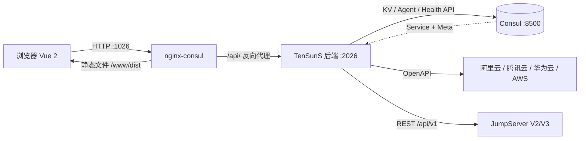
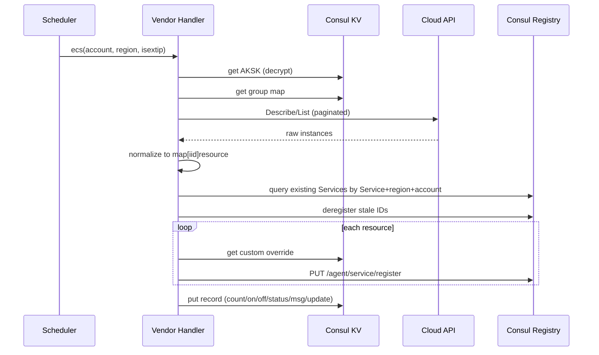
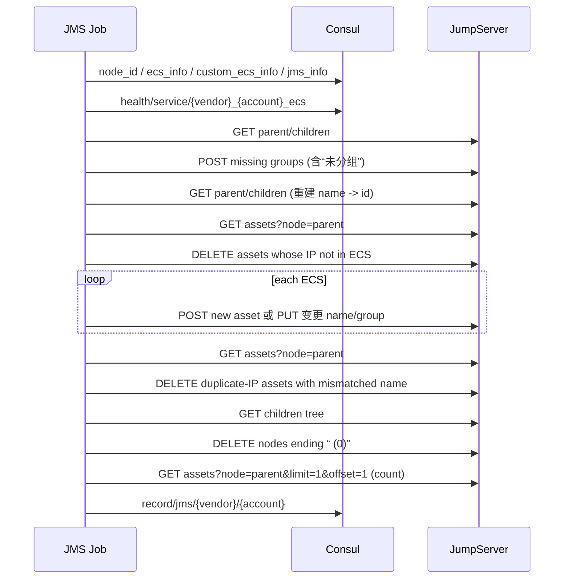

# TenSunS 迁移基线（Python → Go）

> 状态：Phase 1 精简后的现状快照  
> 适用代码：当前仓库 `flask-consul/` + `vue-consul/`  
> 目标：在**不修改现有前端**、**不迁移现有 Consul 数据**的前提下，用 Go 重写后端，并保持可回滚。
>
> Go 骨架进度：[Go 迁移进度与骨架说明](Go迁移进度.md)

本文不是功能规划，也不是架构介绍，而是 Go 重写的行为契约。文中：

- **MUST**：Go 版本必须保持，否则现有前端、Consul 数据或 JumpServer 资产会出问题。
- **SHOULD**：建议保持；如要改变，需要同步调整前端或明确迁移方案。
- **MAY**：实现方式自由。

---

## 1. 范围与迁移结论

### 1.1 保留的能力

| 能力 | 说明 |
| --- | --- |
| 管理员登录 | 单用户 `admin`，密码来自环境变量 `admin_passwd`；无 LDAP、无自定义登录页。 |
| 云账户接入 | 阿里云、腾讯云、华为云、AWS；保存 AK/SK，创建资源组同步任务与资源同步任务。 |
| 资源组同步 | 将云厂商的资源组/项目/企业项目同步到 Consul KV。 |
| ECS 同步 | 将云主机同步为 Consul Service，供列表和 JumpServer 同步使用。 |
| 云 MySQL 同步 | 仅同步 MySQL 类型实例（各云厂商实现见第 7 节）。 |
| 云 Redis 同步 | 同步云 Redis 实例。 |
| 资源列表 | ECS、云 MySQL、云 Redis 列表，支持按数据源筛选、自定义实例 IP/端口。 |
| JumpServer 同步 | 将 ECS 主机按资源组同步到 JumpServer V2/V3 的指定节点。 |

### 1.2 已删除、明确不保留的能力

- 自建主机、自建 MySQL、自建 Redis 的注册与管理。
- Blackbox 站点监控、Prometheus 配置/规则生成、Grafana、TenSunS Exporter。
- AVD 漏洞通知。
- 余额/到期通知。
- Consul Web UI。
- LDAP、自定义 Logo/标题/背景、自定义登录页。
- Dashboard、快捷入口。
- Azure 云（当前代码中已无）。
- 云监控指标采集、告警规则管理。

这些能力的旧 KV 或旧 Service 可能仍残留在已有 Consul 中。**Go 版本不读取、不删除、不修复它们**；升级不需要清理，但也不能因为读到它们而报错。

### 1.3 迁移必须保持的契约

| 契约 | 位置 | 原因 |
| --- | --- | --- |
| HTTP API 路径、请求体、响应字段 | 第 6 节 | 现有 Vue 前端不修改即可复用。 |
| Consul KV 路径与 JSON 结构 | 第 4 节 | 已有云账户、AK/SK、任务、记录必须可读。 |
| Consul Service 名称、Tags、Meta | 第 4.4 节 | 资源列表、JumpServer 同步、旧数据都依赖。 |
| 定时任务 ID、`func`、`args`、`minutes` | 第 5 节 | 已有任务必须在 Go 启动后继续运行。 |
| AES 密文格式 | 第 9.1 节 | 已有 AK/SK、JumpServer Token 必须能解密。 |
| 登录 Token 格式 | 第 9.2 节 | 迁移期间可保持已登录会话；也可选择强制重新登录。 |
| 记录时间格式与状态码 | 第 5.5、6.1 节 | 前端直接展示，且任务创建/手动执行会读取记录状态。 |

**结论：Go 版本应当先做“同契约重写”，不要在第一版修改 KV 结构、API 字段或 Service Meta。** 需要修复的历史缺陷集中列在第 12 节，修复前先确认是否接受前端展示变化。

---

## 2. 运行架构与部署

### 2.1 拓扑



### 2.2 组件职责

| 组件 | 职责 | Go 重写后的形态 |
| --- | --- | --- |
| `vue-consul` | 静态前端；Hash 路由；axios 统一带 `Authorization`；不包含 mock。 | 不改，继续由 nginx 提供。 |
| `flask-consul` | HTTP API、登录鉴权、Consul 读写、云同步、JumpServer 同步、进程内定时调度。 | 替换为单个 Go 二进制/容器，仍监听 `2026`。 |
| `consul` | KV 数据库 + 服务注册中心；ACL 默认拒绝。 | 不改。 |
| `nginx-consul` | 监听 `1026`；`/api/` 代理到后端，`/` 提供前端静态文件。 | 不改。 |

当前没有 MySQL、Redis、消息队列等外部依赖。**不要把 Consul 换成数据库**，否则现有数据和部署方式都会失效。

### 2.3 Docker Compose 部署

`install/docker-compose/all_install.sh` 生成三个服务：

| 服务 | 容器名 | 端口 | 说明 |
| --- | --- | --- | --- |
| `consul` | `consul` | `8500:8500` | 单节点；数据目录 `/consul/data`；配置目录 `/consul/config`；ACL 默认拒绝。 |
| `flask-consul` | `flask-consul` | 仅内网 `2026` | 环境变量见 2.5；依赖 Consul。 |
| `nginx-consul` | `nginx-consul` | `1026:1026` | 对用户暴露的唯一入口。 |

`tensuns_install_only.sh` 只启动后两个容器，要求已有 Consul。K8S 安装中：

- 命名空间：`tensuns`
- 后端 Service：`2026`
- nginx Service：`1026`，NodePort `31026`
- Consul Service：`8500`
- 容器时区：`Asia/Shanghai`

Docker Compose 通过挂载 `/usr/share/zoneinfo/PRC:/etc/localtime` 使用中国时区。**记录时间、任务下次执行时间、到期日都按本地时间展示**，Go 进程必须运行在同一时区（建议显式设置 `TZ=Asia/Shanghai`）。

### 2.4 启动顺序

Python 版启动逻辑（`manager.py`）：

1. 请求 Consul `/operator/autopilot/state`；404 时回退 `/operator/autopilot/health`。非 200 直接退出。
2. 检查 `ConsulManager/assets/secret/skey`：
   - 不存在时生成 `uuid4` 去掉 `-` 的 32 位十六进制字符串；
   - 写入 `skey`，同时写一份 `bak-skey{YYYY-MM-DD_HH-MM-SS}` 备份；
   - 已存在时绝不覆盖。
3. 注册 Flask 蓝图与路由。
4. 读取 `ConsulManager/jobs`（云任务）和 `ConsulManager/jms/jobs`（JumpServer 任务），合并后交给进程内 APScheduler。
5. 启动调度器并监听 `0.0.0.0:2026`。

Go 版本 MUST 保持第 1、2 步的语义。**已有 Consul 中绝对不能重新生成 `skey`**，否则所有 AK/SK 与 JumpServer Token 都无法解密。

### 2.5 环境变量

| 变量 | 必填 | 代码默认值 | 说明 |
| --- | --- | --- | --- |
| `consul_url` | 是 | `http://10.5.148.67:8500/v1` | 必须包含 `/v1`，不要以 `/` 结尾；后端会拼接 `/kv/...`、`/agent/...`。 |
| `consul_token` | 是 | 代码内占位 UUID | Consul ACL Token，所有请求带 `X-Consul-Token`。 |
| `admin_passwd` | 是 | `123456` | 登录密码；生产必须修改。 |
| `log_level` | 否 | `INFO` | 日志级别。 |

Go 可以保留同名环境变量；不要新增必须修改部署文件的变量。生产部署脚本使用 `consul_url=http://consul:8500/v1`。

### 2.6 单实例约束

当前调度器是**进程内 APScheduler**，没有分布式锁，也没有选主。K8S `replicas: 1`。Go 版本必须满足以下之一：

- 继续只部署一个后端实例；或
- API 层可以多副本，但只有获得 leader 的实例启动调度器。

**禁止 Python 与 Go 同时运行调度器。** 两边会同时读取同一批任务、重复调用云 API、重复注册/删除 Consul Service 和 JumpServer 资产。迁移切换时必须先停掉旧调度器。

---

## 3. 命名与基础概念

### 3.1 云厂商标识

代码内部与 Consul 路径使用左侧 key；前端展示使用右侧名称。

| 内部 key | 展示名 |
| --- | --- |
| `alicloud` | 阿里云 |
| `tencent_cloud` | 腾讯云 |
| `huaweicloud` | 华为云 |
| `awscloud` | AWS云 |

### 3.2 账户、区域、实例

- `account`：云账户标识，由用户输入。它会进入 KV 路径、任务 ID 和 Service 名称，**不得包含 `/`**；当前代码不做额外校验。
- `region`：区域代码，例如 `cn-hangzhou`、`ap-guangzhou`。资源组任务统一使用 `none` 作为区域占位。
- `iid`：云实例 ID，同时作为 Consul Service ID。要求在同一 Consul Agent 内唯一；当前代码没有处理跨账户 IID 冲突。
- `itype`：资源类型，固定为 `ecs`、`rds`、`redis`；资源组任务中为 `group`。

### 3.3 Service 与任务命名

| 对象 | 规则 | 示例 |
| --- | --- | --- |
| ECS Service 名 | `{vendor}_{account}_ecs` | `alicloud_main_ecs` |
| RDS Service 名 | `{vendor}_{account}_rds` | `tencent_cloud_prod_rds` |
| Redis Service 名 | `{vendor}_{account}_redis` | `huaweicloud_main_redis` |
| 资源组任务 ID | `{vendor}/{account}/group` | `alicloud/main/group` |
| 资源任务 ID | `{vendor}/{account}/{itype}/{region}` | `alicloud/main/ecs/cn-hangzhou` |
| JMS 任务 ID | `{vendor}/{account}/jms` | `alicloud/main/jms` |

> 注意：JMS 任务的 **ID** 是 `vendor/account/jms`，但它的 **KV 路径**是 `ConsulManager/jms/jobs/vendor/account`，两者不同，见第 5 节。

---

## 4. Consul 数据契约

### 4.1 读写约定

- 所有 KV 值都是 UTF-8 JSON；单值读取用 `GET /v1/kv/{path}?raw`，子树读取用 `?recurse`。
- Python `put_kv` 直接把 `json.dumps(value, ensure_ascii=False)` 作为请求体，Consul 返回的 Value 是原文的 Base64。
- `get_value(path)`：HTTP 200 时 `response.json()`，否则返回 `{}`。
- `get_kv_dict(path)`：递归读取，过滤 `Value != null`，返回 `{完整 Key: 解析后的 JSON}`；空结果返回 `{}`。
- `get_keys_list(path)`：`?keys`，返回完整 Key 列表。
- 所有请求头：`X-Consul-Token: {consul_token}`。
- 没有 TTL、Session、锁、事务；更新是逐 Key 覆盖写，可能部分成功。
- Go 写 JSON 时建议 `SetEscapeHTML(false)`，避免把中文或 `<>&` 转义成 `\uXXXX`。JSON 语义不变，但保持与旧数据一致的字节风格更利于排查。

### 4.2 KV 清单

| 路径 | 写入方 | 读取方 | 用途 |
| --- | --- | --- | --- |
| `ConsulManager/assets/secret/skey` | 启动初始化 | 所有加解密 | AES 密钥，`{"sk":"32位十六进制"}`。 |
| `ConsulManager/assets/secret/bak-skey{时间}` | 启动初始化 | 人工恢复 | 密钥备份。 |
| `ConsulManager/assets/{vendor}/aksk/{account}` | 创建/编辑云账户 | 云同步任务 | 加密后的 AK/SK。 |
| `ConsulManager/assets/{vendor}/group/{account}` | 资源组任务 | ECS/RDS/Redis 同步、JMS | 资源组 ID → 展示名。 |
| `ConsulManager/assets/sync_ecs_custom/{iid}` | 自定义实例接口 | ECS 同步 | ECS 自定义 IP/端口。 |
| `ConsulManager/assets/sync_rds_custom/{iid}` | 自定义实例接口 | RDS 同步 | RDS 自定义 IP/端口。 |
| `ConsulManager/assets/sync_redis_custom/{iid}` | 自定义实例接口 | Redis 同步 | Redis 自定义 IP/端口。 |
| `ConsulManager/jobs/{vendor}/{account}/group` | 创建任务 | 启动加载、任务列表 | 资源组任务。 |
| `ConsulManager/jobs/{vendor}/{account}/{itype}/{region}` | 创建/编辑任务 | 启动加载、任务列表 | ECS/RDS/Redis 任务。 |
| `ConsulManager/jms/jobs/{vendor}/{account}` | 开启 JMS 同步 | 启动加载、JMS 列表 | JMS 任务。 |
| `ConsulManager/record/jobs/{vendor}/{account}/group` | 资源组任务 | 任务列表、JMS 列表 | 资源组执行记录。 |
| `ConsulManager/record/jobs/{vendor}/{account}/{itype}/{region}` | 资源任务 | 任务列表 | 资源执行记录。 |
| `ConsulManager/record/jms/{vendor}/{account}` | JMS 任务 | JMS 列表 | JMS 执行记录。 |
| `ConsulManager/jms/jms_info` | JMS 配置接口 | JMS 任务 | JumpServer URL、加密 Token、版本。 |
| `ConsulManager/jms/ecs_info` | JMS 配置接口 | JMS 任务 | 全局协议与管理用户。 |
| `ConsulManager/jms/custom_ecs_info` | JMS 配置接口 | JMS 任务 | 按主机名关键字覆盖的管理用户。 |
| `ConsulManager/jms/{vendor}/{account}/node_id` | JMS 同步开关 | JMS 任务 | 父节点 ID 与同步间隔。 |
| `ConsulManager/jms/{vendor}/{account}/ecs_info` | 人工/未来扩展 | JMS 任务 | **可选**账户级协议覆盖。 |
| `ConsulManager/jms/{vendor}/{account}/custom_ecs_info` | 人工/未来扩展 | JMS 任务 | **可选**账户级自定义覆盖。 |

旧版本可能残留但不读取的路径：`ConsulManager/avd/jobs`、`ConsulManager/exp/jobs`、`ConsulManager/img/*`、自建资源相关 Service/KV。Go 不得因为存在这些数据而启动失败。

### 4.3 关键 JSON 结构

#### 4.3.1 密钥

```json
{"sk": "0123456789abcdef0123456789abcdef"}
```

`sk` 必须是 32 个 UTF-8 字节（AES-256）。初始化逻辑等价于：

```text
skeyuid = uuid4().hex   # 32 个十六进制字符，无连字符
```

#### 4.3.2 AK/SK

```json
{
  "ak": "Base64(AES-CBC(iv + ciphertext))",
  "sk": "Base64(AES-CBC(iv + ciphertext))"
}
```

AK 与 SK 分别加密；每次加密使用独立随机 IV，同一明文每次结果不同。

#### 4.3.3 资源组

```json
{
  "rg-xxxxxxxx": "默认资源组",
  "rg-yyyyyyyy": "生产资源组"
}
```

阿里云是 ResourceGroup ID；腾讯云是 ProjectId；华为云是企业项目 ID；AWS 固定为 `{"1":"1"}`。

#### 4.3.4 自定义实例

```json
{"port": 2222, "ip": "10.0.0.12"}
```

- `port` 为整数，`ip` 为字符串；可以只有其中一个。
- 空对象 `{}` 表示没有有效覆盖；资源列表的“仅显示修改过的”会过滤掉空对象。
- 自定义值在下一次云同步时生效；接口本身会立即改写当前 Service 的 Address/Port/Meta.instance。

#### 4.3.5 任务

资源组任务：

```json
{
  "id": "alicloud/main/group",
  "func": "__main__:alicloud.group",
  "args": ["main"],
  "minutes": 60,
  "trigger": "interval",
  "replace_existing": true
}
```

ECS 任务：

```json
{
  "id": "alicloud/main/ecs/cn-hangzhou",
  "func": "__main__:alicloud.ecs",
  "args": ["main", "cn-hangzhou", false],
  "minutes": 10,
  "trigger": "interval",
  "replace_existing": true
}
```

JMS 任务（注意 KV 路径）：

```json
{
  "id": "alicloud/main/jms",
  "func": "__main__:sync_jms.run",
  "args": ["alicloud", "main"],
  "minutes": 3,
  "trigger": "interval",
  "replace_existing": true
}
```

#### 4.3.6 执行记录

资源组：

```json
{"count": 12, "update": "10.23/14:10", "status": 20000, "msg": "同步资源组成功！总数：12"}
```

ECS/RDS/Redis：

```json
{
  "count": 12,
  "update": "10.23/14:10",
  "status": 20000,
  "on": 10,
  "off": 2,
  "msg": "ECS同步成功！总数：12，开机：10，关机：2"
}
```

JMS：

```json
{"count": 12, "update": "1023/14:10", "status": 20000, "msg": "同步资源成功！总数：12"}
```

失败记录至少包含 `count`、`update`、`status`、`msg`；`count` 可能是字符串 `"无"`，`update` 可能是 `"失败..."`。已有记录上的失败更新行为见第 7.6 节。

#### 4.3.7 JumpServer 配置

`jms_info`：

```json
{
  "url": "https://jumpserver.example.com",
  "token": "Base64(AES-CBC(iv + ciphertext))",
  "ver": "V3"
}
```

`ver` 取值 `V2` 或 `V3`；旧数据可能没有 `ver`，按 `V2` 处理。

`ecs_info`：

```json
{
  "linux": [["ssh/22"], "root"],
  "windows": [["rdp/3389"], "Administrator"]
}
```

- 第一个元素是协议列表，格式 `协议/端口`；当前 UI 只生成一个协议。
- 第二个元素是管理用户：V2 作为 `admin_user`，V3 作为账号模板 `template`。
- 前端配置项名称是 `linuxport`、`linuxuid`、`winport`、`winuid`；`uid` 在 V3 中实际是模板 ID/名称，不是数字用户 ID。

`custom_ecs_info`：

```json
{
  "prod-web": {
    "linux": [["ssh/2222"], "root"],
    "windows": [["rdp/3389"], "Administrator"]
  }
}
```

键是主机名关键字，匹配时大小写不敏感、子串匹配；多个键命中时的覆盖顺序见第 8.6 节。

`node_id`：

```json
{"node_id": "xxxxxxxx-xxxx-xxxx-xxxx-xxxxxxxxxxxx", "interval": 3}
```

`node_id` 原样拼进 JumpServer URL；`interval` 为分钟，前端可能传字符串，后端用 `int()` 转换。

### 4.4 Consul Service 契约

#### 4.4.1 注册体

ECS/RDS/Redis 同步都调用：

```text
PUT {consul_url}/agent/service/register
```

请求体示例（ECS）：

```json
{
  "id": "i-xxxxxxxx",
  "name": "alicloud_main_ecs",
  "Address": "10.0.0.12",
  "port": 9100,
  "tags": ["ON", "linux", "cn-hangzhou"],
  "Meta": {
    "iid": "i-xxxxxxxx",
    "name": "prod-web-01",
    "region": "华东1(杭州)",
    "group": "生产资源组",
    "instance": "10.0.0.12:9100",
    "account": "main",
    "vendor": "阿里云",
    "os": "linux",
    "cpu": "4核",
    "mem": "8GB",
    "exp": "2026-01-01",
    "stat": "on"
  },
  "check": {"tcp": "10.0.0.12:9100", "interval": "60s"}
}
```

Consul JSON 字段大小写不敏感；Python 混用了 `id/name/port/tags/check` 小写和 `Address/Meta` 大写。Go 建议统一使用 Consul 官方字段名（`ID`、`Name`、`Address`、`Port`、`Tags`、`Meta`、`Check`），服务端结果等价。

#### 4.4.2 Service 名称与 Tags

| 资源 | Service 名 | Tags |
| --- | --- | --- |
| ECS | `{vendor}_{account}_ecs` | `["ON" 或 "OFF", os, region]` |
| RDS | `{vendor}_{account}_rds` | `["ON" 或 "OFF", itype, ver, region]` |
| Redis | `{vendor}_{account}_redis` | `["ON" 或 "OFF", itype, ver, region]` |

`region` 是区域代码，不是展示名。删除资源时的过滤条件依赖 Tags 中的区域代码和 `Meta.account`。

#### 4.4.3 ECS Meta

| Key | 类型 | 说明 |
| --- | --- | --- |
| `iid` | string | 云实例 ID。 |
| `name` | string | 实例名称。 |
| `region` | string | 区域展示名，未找到时为 `未找到`。 |
| `group` | string | 资源组展示名；找不到时为 `无`。 |
| `instance` | string | `地址:端口`，地址可能是自定义 IP 或外网 IP。 |
| `account` | string | 账户标识。 |
| `vendor` | string | 厂商标识的展示名，未找到时为 `未找到`。 |
| `os` | string | `linux` / `windows`。 |
| `cpu` | string | 例如 `4核`。 |
| `mem` | string | 例如 `8GB`。 |
| `exp` | string | 到期日、`按量` 或 `-`。 |
| `stat` | string | `on` / `off`。 |
| 云标签 | string | 阿里云/Tencent 的标签键仅保留字母数字（`TagKey.encode().isalnum()`），同名字段会覆盖上面的值。 |

#### 4.4.4 RDS Meta

| Key | 说明 |
| --- | --- |
| `iid`、`name`、`region`、`group`、`instance`、`account`、`itype`、`vendor`、`disk`、`cpu`、`mem`、`ver`、`domain`、`exp`、`stat` | 同 ECS 语义；`instance` 为 `IP:端口`。 |
| `team` | 仅华为云从标签 `team` 提取；缺省 `无`。 |

#### 4.4.5 Redis Meta

| Key | 说明 |
| --- | --- |
| `iid`、`name`、`region`、`group`、`instance`、`account`、`itype`、`vendor`、`mem`、`ver`、`exp`、`stat` | 同 ECS 语义。 |
| `ip` | 云厂商返回的 `ip` 字段；多数是内网 IP，腾讯云当前是 `WanIp`（公网）。不是 Service Address。 |

Redis 的 Service Address 默认使用云厂商提供的连接域名（`domain`），不是 `Meta.ip`；只有配置自定义 IP 时才改 Address。资源列表展示 `Meta.instance`，tooltip 展示 `Meta.ip`。

#### 4.4.6 清理不存在的资源

每次资源同步先查询：

```text
GET {consul_url}/agent/services
    ?filter=Service == "{service_name}" and "{region}" in Tags and Meta.account == "{account}"
```

然后把返回的 Service ID 与本次云 API 返回的 `iid` 集合比较，**删除云上不存在的 ID**：

```text
PUT {consul_url}/agent/service/deregister/{iid}
```

注意事项：

- 如果云 API 正常返回空列表，会删除该账户/区域下该类型的全部 Service。这是当前行为，Go 不要因为列表为空就跳过清理。
- 清理只按 Service 名 + 区域 + 账户过滤，不会删除自定义 KV。
- 注册是逐个 Service 覆盖写；中途失败会留下部分旧数据、部分新数据。
- 资源从一个资源组移动到另一个资源组时，下一次同步会更新 `Meta.group`，不会重建 Service。

#### 4.4.7 自定义实例的即时修改

`POST /api/nodes/cstecs`、`/api/rds/cstrds`、`/api/redis/cstredis` 会：

1. 读取当前 Service：`GET /v1/agent/service/{iid}`。
2. 按开关修改 `Address`、`Port`。
3. 写自定义 KV（`sync_*_custom/{iid}`）。
4. 更新 `Meta.instance = Address:Port`。
5. 把 `check` 改为 `{"tcp":"Address:Port","interval":"60s"}`。
6. 先 deregister，再 register。

Python 在重注册前删除了 Consul 返回的只读字段：`Weights`、`ContentHash`、`Datacenter`；ECS 还删除了 `TaggedAddresses`。Go 更稳妥的做法是**重新构造注册体**：保留 `Service`、`Tags`、`Meta`，使用新的 Address/Port/Check 注册，不要直接把 GET 的完整响应回传。

重要语义：

- 关闭所有自定义开关后，接口只写空 KV，**不会立即恢复云默认地址/端口**；仍然注册当前的 Address/Port。页面上的提示也要求“关闭后再同步一次所属数据源”。
- 只打开端口开关时，IP 保持当前值；只打开 IP 开关时，端口保持当前值。
- 自定义修改不会触发云同步，也不会改变 Service 名称或 Tags。
- 下一次云同步会读取自定义 KV 并覆盖 Service 的地址/端口。

---

## 5. 定时任务契约

### 5.1 任务模型

Python 使用 Flask-APScheduler，任务配置只存在 Consul KV 中，APScheduler 本身不持久化。启动时把 KV 中的任务全部加载进内存；运行期间的新增、删除、改间隔会同时改内存与 KV。

每个任务的 KV 值：

```json
{
  "id": "alicloud/main/ecs/cn-hangzhou",
  "func": "__main__:alicloud.ecs",
  "args": ["main", "cn-hangzhou", false],
  "minutes": 10,
  "trigger": "interval",
  "replace_existing": true
}
```

内存中额外使用：

- `misfire_grace_time=100` 秒；
- APScheduler 默认 `max_instances=1`，同一个任务上一次未结束时不会并发执行下一次。

### 5.2 任务矩阵

| 类型 | Job ID | KV 路径 | `func` | `args` |
| --- | --- | --- | --- | --- |
| 资源组 | `{vendor}/{account}/group` | `ConsulManager/jobs/{job_id}` | `__main__:{vendor}.group` | `[account]` |
| ECS | `{vendor}/{account}/ecs/{region}` | `ConsulManager/jobs/{job_id}` | `__main__:{vendor}.ecs` | `[account, region, isextip]` |
| RDS | `{vendor}/{account}/rds/{region}` | `ConsulManager/jobs/{job_id}` | `__main__:{vendor}.rds` | `[account, region]` |
| Redis | `{vendor}/{account}/redis/{region}` | `ConsulManager/jobs/{job_id}` | `__main__:{vendor}.redis` | `[account, region]` |
| JumpServer | `{vendor}/{account}/jms` | `ConsulManager/jms/jobs/{vendor}/{account}` | `__main__:sync_jms.run` | `[vendor, account]` |

要点：

- `vendor` 在 `func` 和 `args` 中都是内部 key，不是“阿里云”这类展示名。
- ECS 的 `args` 创建时固定为 3 个；编辑接口在旧任务只有 2 个参数时会追加 `isextip`。Go 读取时应兼容 2 个或 3 个参数，缺省 `isextip=false`。
- 资源组任务的 `region` 不在 ID 中；资源任务的 ID 必须包含区域代码。
- `minutes` 必须是正整数。
- 当前没有 `cron` 表达式、没有一次性任务、没有暂停状态；关闭 JMS 同步的方式是删除任务。

### 5.3 任务生命周期

#### 启动加载

```text
ecs_jobs = get_kv_dict("ConsulManager/jobs")
jms_jobs = get_kv_dict("ConsulManager/jms/jobs")
init_jobs = merge(ecs_jobs, jms_jobs)
for job in init_jobs:
    scheduler.add_job(id=job.id, func=job.func, args=job.args,
                      trigger="interval", minutes=job.minutes,
                      replace_existing=True, misfire_grace_time=100)
```

Go 必须能识别上述 5 种 `func`。未知 `func`（例如旧版本残留的 `exp`、`avd`）建议：

- 记录错误日志并跳过调度；
- 不删除 KV；
- API 查询到该任务时不要崩溃，`nextime` 可返回 `"无"`。

不要因为一个未知任务导致整个服务启动失败。

#### 创建云账户任务

`POST /api/jobs` 且 `dialogStatus=create`：

1. 覆盖写入 AK/SK。
2. 从 `restype` 中移除 `group`（前端必传 `group`；缺失会导致当前 Python 返回 500）。
3. 添加并**立即执行**资源组任务。
4. 读取资源组记录 `ConsulManager/record/jobs/{vendor}/{account}/group`。
5. 只有记录 `status == 20000` 时：
   - 写入资源组任务 KV；
   - 为 `restype` 中的每种资源、`region` 中的每个区域创建任务并写 KV。
6. 失败时只移除内存中的资源组任务，不写资源组任务 KV，不创建资源任务。
7. 返回资源组记录的 `status` 和 `"{update}：{msg}"`。

注意：**创建时不会立即执行 ECS/RDS/Redis 任务**，它们要等到间隔到期。Go 应保持这一点，否则创建账户后的第一次云 API 调用次数和用户预期会变化。

#### 修改任务间隔

`POST /api/jobs` 且 `dialogStatus=update`：

- 修改内存任务 `trigger=interval, minutes=interval`；
- 读取 KV，更新 `minutes` 后写回；
- 返回 `{"code":20000,"data":"更新成功！"}`。

#### 手动执行

`POST /api/jobs` 且 `dialogStatus=run`：

- 立即执行任务；
- 读取对应记录并返回 `status`/`"{update}：{msg}"`。

Go 应做到“执行完成后再读记录”，否则会读到上一次的旧记录。当前 Python 的 `Scheduler.run_job` 在 APScheduler 执行器中同步/异步行为取决于配置；实际使用中前端会等待响应。Go 建议直接同步执行并等待完成，返回本次记录。

#### 删除任务

`DELETE /api/jobs?job_id=...`：

- 从调度器移除；
- 删除 `ConsulManager/jobs/{job_id}`；
- 返回成功。

**不会级联删除**同一账户/区域下的其他任务。删除 `group` 任务不会删除 ECS/RDS/Redis 任务；这是当前行为。

#### JMS 开启/关闭

- `POST /api/jms/switch` 且 `sync=true`：只读取 `node_id` KV，返回 `interval` 和 `nodeid`，不创建任务。
- `POST /api/jms/sync`：校验 `nodeid` 非空，写 `node_id` KV，添加任务，立即执行；执行成功后才写 `ConsulManager/jms/jobs/{vendor}/{account}`；执行异常则移除内存任务并返回 50000。
- `POST /api/jms/switch` 且 `sync=false`：移除内存任务并删除 `ConsulManager/jms/jobs/{vendor}/{account}`；保留 `node_id` KV。

### 5.4 Go 调度器实现建议

最低要求：

| 能力 | 说明 |
| --- | --- |
| Upsert | 相同 Job ID 重复加载/创建时替换，不产生重复任务。 |
| Remove | 按 ID 删除。 |
| Update interval | 不重建任务也能修改间隔。 |
| Run now | 立即执行并等待本次执行结束。 |
| Next run time | 能返回下一次执行时间，格式 `%m.%d/%H:%M`。 |
| Per-job lock | 同一 Job ID 不并发执行。 |
| Local timezone | 使用进程本地时区（生产为 Asia/Shanghai）。 |
| No dual scheduler | 单实例或 leader 选举。 |

实现方式可以是每个任务一个 goroutine + `time.Timer`，也可以用支持动态增删的 cron 库；不需要引入 Redis/数据库。关键是把 `func` 字符串映射为 Go 的强类型任务：

```text
__main__:alicloud.group       -> CloudGroup{Vendor:"alicloud"}
__main__:alicloud.ecs         -> CloudECS{Vendor:"alicloud"}
__main__:alicloud.rds         -> CloudRDS{Vendor:"alicloud"}
__main__:alicloud.redis       -> CloudRedis{Vendor:"alicloud"}
__main__:tencent_cloud.ecs    -> CloudECS{Vendor:"tencent_cloud"}
__main__:huaweicloud.rds      -> CloudRDS{Vendor:"huaweicloud"}
__main__:awscloud.redis       -> CloudRedis{Vendor:"awscloud"}
__main__:sync_jms.run         -> JMSSync
```

未知 `func` 不要 panic；记录并跳过。任务记录中保留原始 `func`，以便回滚到 Python。

### 5.5 时间格式

| 场景 | 格式 | 示例 |
| --- | --- | --- |
| 云任务记录 `update` | `%m.%d/%H:%M` | `10.23/14:10` |
| JMS 记录 `update` | `%m%d/%H:%M` | `1023/14:10` |
| 任务列表 `nextime` | `%m.%d/%H:%M` | `10.23/15:10` |
| JMS 列表 `nextime` | `%m.%d/%H:%M` | `10.23/15:10` |
| JMS 列表 `runtime` | 来自 JMS 记录，`%m%d/%H:%M` | `1023/14:10` |

这个不一致是现状，前端直接展示字符串。Go 第一版 MUST 保持，避免 UI 出现两种日期格式混杂；后续如果要统一，应同时改前端或做兼容层。

---

## 6. HTTP API 契约

### 6.1 通用约定

- 所有接口前缀 `/api`；JSON 请求/响应；没有 API 版本号。
- 除登录、登出外，都需要请求头：

```http
Authorization: Bearer <token>
```

- 登录、登出本身不要求 Token；`/api/user/info` 要求 Token。
- Token 校验失败返回 **HTTP 200**：

```json
{"code": 50000, "data": "403：认证异常，请重新登录！"}
```

- 业务成功码 `20000`；密码错误 `40000`；通用失败/认证失败 `50000`。云任务失败也通过 `status=50000` 写入记录，再由任务创建/手动执行接口返回。
- 前端 axios 拦截器以 `res.code !== 20000` 判断失败；它只对 `50008/50012/50014` 做自动重新登录，对 `50000` 只弹错误提示。Go 若改成 HTTP 401/403，前端不会按预期处理。
- 列表接口的字段通常在**顶层**，不包在 `data` 里；只有登录、JMS 配置等接口返回 `data` 或 `jms_config`。
- GET 筛选参数 `query_dict` 是 **URL 编码的 JSON 字符串**，不是 JSON 对象。
- `checked` 是字符串 `"true"`/`"false"`。
- 请求体通常有包装键：`job_dict`、`editJob`、`cst_ecs_dict`、`cst_rds_dict`、`cst_redis_dict`、`jms_config`、`switch_dict`、`jms_sync`。
- 前端会传 `username`，但后端登录只校验密码；`/api/user/info` 固定返回 `admin`。

### 6.2 接口总表

| # | 方法 | 路径 | 用途 |
| --- | --- | --- | --- |
| 1 | POST | `/api/user/login` | 登录。 |
| 2 | POST | `/api/user/logout` | 登出。 |
| 3 | GET | `/api/user/info` | 当前用户信息。 |
| 4 | GET | `/api/jobs` | 云任务列表。 |
| 5 | POST | `/api/jobs` | 创建/改间隔/手动执行。 |
| 6 | DELETE | `/api/jobs` | 删除任务。 |
| 7 | GET | `/api/edit/cloud` | 已接入的云账户。 |
| 8 | GET | `/api/edit/find` | 查询账户在区域下的任务配置。 |
| 9 | POST | `/api/edit/commit` | 编辑账户任务配置。 |
| 10 | GET | `/api/nodes/group` | 资源组列表。 |
| 11 | GET | `/api/nodes/res` | ECS/MySQL/Redis 资源列表（Meta）。 |
| 12 | GET | `/api/nodes/jobecs` | 所有 ECS 任务 ID。 |
| 13 | GET | `/api/nodes/cstecsconf` | 查询 ECS 自定义配置。 |
| 14 | GET | `/api/nodes/cstecslist` | 查询 ECS 列表（全部/仅自定义）。 |
| 15 | POST | `/api/nodes/cstecs` | 保存 ECS 自定义配置。 |
| 16 | GET | `/api/rds/jobrds` | 所有 RDS 任务 ID。 |
| 17 | GET | `/api/rds/cstrdsconf` | 查询 RDS 自定义配置。 |
| 18 | GET | `/api/rds/cstrdslist` | 查询 RDS 列表（全部/仅自定义）。 |
| 19 | POST | `/api/rds/cstrds` | 保存 RDS 自定义配置。 |
| 20 | GET | `/api/redis/jobredis` | 所有 Redis 任务 ID。 |
| 21 | GET | `/api/redis/cstredisconf` | 查询 Redis 自定义配置。 |
| 22 | GET | `/api/redis/cstredislist` | 查询 Redis 列表（全部/仅自定义）。 |
| 23 | POST | `/api/redis/cstredis` | 保存 Redis 自定义配置。 |
| 24 | GET | `/api/jms/list` | JumpServer 同步账户列表。 |
| 25 | GET | `/api/jms/config` | 查询 JumpServer 配置。 |
| 26 | POST | `/api/jms/config` | 保存 JumpServer 配置。 |
| 27 | POST | `/api/jms/switch` | 打开/关闭 JMS 同步。 |
| 28 | POST | `/api/jms/sync` | 设置节点并立即首次同步。 |

### 6.3 登录与用户

#### POST `/api/user/login`

请求：

```json
{"username": "admin", "password": "******"}
```

成功：

```json
{
  "code": 20000,
  "data": {
    "token": "Bearer eyJhbGciOiJIUzUxMiIs...",
    "username": "admin"
  }
}
```

失败：

```json
{"code": 40000, "data": "密码错误！"}
```

说明：

- 密码只与 `admin_passwd` 比较；`username` 不校验。
- 返回的 Token 已经带 `Bearer ` 前缀；前端原样存入 localStorage，axios 再放入 `Authorization`。
- Token 有效期 8 小时（`28800` 秒）。

#### POST `/api/user/logout`

无请求体；返回：

```json
{"code": 20000, "data": "success"}
```

当前不做服务端 Token 失效（无黑名单）。

#### GET `/api/user/info`

```json
{
  "code": 20000,
  "data": {"roles": ["admin"], "name": "admin", "avatar": "/harbor-mark.svg"}
}
```

前端会额外带 `?token=...`，后端忽略，实际使用 `Authorization`。

### 6.4 云任务接口

#### GET `/api/jobs`

请求：

```text
GET /api/jobs?query_dict={"vendor":"","account":"","itype":""}
```

`query_dict` JSON 字段：

| 字段 | 说明 |
| --- | --- |
| `vendor` | 展示名（如 `阿里云`）；空字符串表示不过滤。 |
| `account` | 账户标识；空字符串表示不过滤。 |
| `itype` | `group` / `ecs` / `rds` / `redis`；空字符串表示不过滤。 |

成功响应：

```json
{
  "code": 20000,
  "all_jobs": [
    {
      "region": "无",
      "vendor": "阿里云",
      "account": "main",
      "itype": "group",
      "interval": 60,
      "jobid": "alicloud/main/group",
      "nextime": "10.23/15:10",
      "on": 0,
      "off": 0,
      "count": 12,
      "runtime": "10.23/14:10"
    }
  ],
  "vendor_list": ["阿里云"],
  "account_list": ["main"],
  "itype_list": ["group"]
}
```

`all_jobs` 字段：

| 字段 | 来源 | 说明 |
| --- | --- | --- |
| `region` | 任务参数/ID | 资源任务为区域展示名；资源组任务为 `无`。 |
| `vendor` | 任务 ID | 展示名。 |
| `account` | 任务 ID | 原样。 |
| `itype` | 任务 ID | `group`/`ecs`/`rds`/`redis`。 |
| `interval` | 任务 KV | `minutes`。 |
| `jobid` | 任务 KV | Job ID。 |
| `nextime` | 调度器 | 下一次执行，`%m.%d/%H:%M`。 |
| `on` / `off` | 记录 | 记录不存在时默认 0。 |
| `count` | 记录 | 记录不存在时为字符串 `"无"`。 |
| `runtime` | 记录 | 记录不存在时为 `"无"`。 |

`vendor_list`、`account_list`、`itype_list` 均来自过滤后的任务集合，排序后返回。

当前 Python 在任务 KV 存在但没有被调度器加载时，`nextime` 会因 `KeyError` 返回 500。Go 建议返回 `"无"`，不要返回 500；这是对前端更安全的兼容改进。

#### POST `/api/jobs`（创建）

请求：

```json
{
  "job_dict": {
    "dialogStatus": "create",
    "vendor": "alicloud",
    "account": "main",
    "ak": "LTAI...",
    "sk": "...",
    "region": ["cn-hangzhou", "cn-shanghai"],
    "restype": ["group", "ecs", "rds", "redis"],
    "proj_interval": 60,
    "ecs_interval": 10,
    "rds_interval": 20,
    "redis_interval": 20,
    "isextip": false
  }
}
```

响应：

```json
{"code": 20000, "data": "10.23/14:10：同步资源组成功！总数：12"}
```

失败时 `code` 为资源组记录的 `status`（通常 50000），`data` 为 `"{update}：{msg}"`。资源组失败不会创建资源任务。

#### POST `/api/jobs`（修改间隔）

```json
{"job_dict": {"dialogStatus": "update", "jobid": "alicloud/main/ecs/cn-hangzhou", "interval": 15}}
```

```json
{"code": 20000, "data": "更新成功！"}
```

#### POST `/api/jobs`（手动执行）

```json
{"job_dict": {"dialogStatus": "run", "jobid": "alicloud/main/ecs/cn-hangzhou"}}
```

```json
{"code": 20000, "data": "10.23/14:20：ECS同步成功！总数：12，开机：10，关机：2"}
```

#### DELETE `/api/jobs?job_id=...`

```json
{"code": 20000, "data": "删除成功！"}
```

只删除指定任务，不级联。

### 6.5 云账户编辑接口

#### GET `/api/edit/cloud`

```json
{
  "code": 20000,
  "cloud_dict": {
    "alicloud": ["main", "prod"],
    "tencent_cloud": ["main"]
  }
}
```

只包含有 `group` 任务的账户；vendor 是内部 key。

#### GET `/api/edit/find?vendor=alicloud&account=main&region=cn-hangzhou`

```json
{
  "code": 20000,
  "restype": ["group", "ecs", "rds"],
  "interval": {
    "proj_interval": 60,
    "ecs_interval": 10,
    "rds_interval": 20,
    "redis_interval": 20
  },
  "isextip": false
}
```

- `restype` 永远至少包含 `group`。
- 默认间隔：`proj=60`、`ecs=10`、`rds=20`、`redis=20`。
- `isextip` 取 ECS 任务 `args[2]`；旧任务参数不足时返回 `false`。

#### POST `/api/edit/commit`

请求：

```json
{
  "editJob": {
    "vendor": "alicloud",
    "account": "main",
    "region": "cn-hangzhou",
    "restype": ["group", "ecs", "rds"],
    "isextip": false,
    "proj_interval": 60,
    "ecs_interval": 10,
    "rds_interval": 20,
    "redis_interval": 20,
    "akskswitch": false,
    "ak": "",
    "sk": ""
  }
}
```

响应：

```json
{"code": 20000, "data": "alicloud/main/cn-hangzhou：编辑成功！"}
```

行为：

- `akskswitch=true` 时覆盖 AK/SK；否则保持。
- 资源组任务必须存在；不存在时当前 Python 会 500（`[0]` 越界）。Go 可以返回更明确的错误，但前端正常流程不会触发。
- 对区域下的 ECS/RDS/Redis：
  - 选中且任务不存在：新建任务并写 KV，不立即执行；
  - 选中且任务存在：按需修改间隔、ECS 的 `isextip`；
  - 未选中且任务存在：删除 KV 和内存任务（`try/except` 吞掉异常）。
- `restype` 中的 `group` 只用于保持资源组任务，不参与删除。

### 6.6 资源组与资源列表接口

#### GET `/api/nodes/group?job_id=alicloud/main/group`

```json
{
  "code": 20000,
  "group": [
    {"gid": "rg-xxxxxxxx", "gname": "默认资源组"},
    {"gid": "rg-yyyyyyyy", "gname": "生产资源组"}
  ]
}
```

`job_id` 必须是 3 段；函数只使用 `cloud`、`account`，`itype` 被忽略。KV 不存在时返回空数组。

#### GET `/api/nodes/res?job_id=alicloud/main/ecs/cn-hangzhou`

```json
{
  "code": 20000,
  "res_list": [
    {
      "iid": "i-xxxxxxxx",
      "name": "prod-web-01",
      "region": "华东1(杭州)",
      "group": "生产资源组",
      "instance": "10.0.0.12:9100",
      "account": "main",
      "vendor": "阿里云",
      "os": "linux",
      "cpu": "4核",
      "mem": "8GB",
      "exp": "2026-01-01",
      "stat": "on"
    }
  ]
}
```

- 返回的是 Consul Service 的 `Meta` 数组，不包含 `Address`、`Port`、`Tags`、健康状态。
- ECS/RDS/Redis 都复用这个接口；`itype` 来自 `job_id` 的第 3 段。
- `job_id` 为空时返回空数组。
- 过滤条件只有 Service 名和区域，没有账户条件；Service 名已包含账户。

#### GET `/api/nodes/jobecs`

```json
{"code": 20000, "jobecs": ["alicloud/main/ecs/cn-hangzhou"]}
```

从 `ConsulManager/jobs` 的 Key 列表里筛选包含 `/ecs/` 的项，去掉 `.../jobs/` 前缀。

#### GET `/api/rds/jobrds`、`/api/redis/jobredis`

同 ECS，返回字段分别为 `jobrds`、`jobredis`，筛选 `/rds/`、`/redis/`。

### 6.7 自定义实例接口

以 ECS 为例，RDS/Redis 结构完全对称。

#### GET `/api/nodes/cstecsconf?iid=i-xxxxxxxx`

无自定义配置时：

```json
{
  "code": 20000,
  "cst_ecs": {"iid": "i-xxxxxxxx", "ipswitch": false, "portswitch": false}
}
```

有自定义配置时：

```json
{
  "code": 20000,
  "cst_ecs": {
    "iid": "i-xxxxxxxx",
    "ip": "10.0.0.12",
    "port": 2222,
    "ipswitch": true,
    "portswitch": true
  }
}
```

#### GET `/api/nodes/cstecslist?jobecs_name=alicloud/main/ecs/cn-hangzhou&checked=false`

- `checked=false`：返回全部资源，结构与 `/api/nodes/res` 相同（`code` + `res_list`）。
- `checked=true`：只返回 iid 在 `sync_ecs_custom` 非空配置中的资源。

#### POST `/api/nodes/cstecs`

请求：

```json
{
  "cst_ecs_dict": {
    "iid": "i-xxxxxxxx",
    "portswitch": true,
    "port": "2222",
    "ipswitch": true,
    "ip": "10.0.0.12"
  }
}
```

响应：

```json
{"code": 20000, "data": "自定义实例信息修改成功！"}
```

异常（例如 Service 不存在）返回：

```json
{"code": 50000, "data": "提交自定义实例信息格式错误！"}
```

RDS/Redis 的路径、包装键、响应键：

| 资源 | 查询配置 | 列表 | 保存 | 请求包装 | 响应键 |
| --- | --- | --- | --- | --- | --- |
| ECS | `/api/nodes/cstecsconf` | `/api/nodes/cstecslist` | `/api/nodes/cstecs` | `cst_ecs_dict` | `cst_ecs` |
| RDS | `/api/rds/cstrdsconf` | `/api/rds/cstrdslist` | `/api/rds/cstrds` | `cst_rds_dict` | `cst_rds` |
| Redis | `/api/redis/cstredisconf` | `/api/redis/cstredislist` | `/api/redis/cstredis` | `cst_redis_dict` | `cst_redis` |

RDS/Redis 列表参数名分别为 `jobrds_name`、`jobredis_name`。

### 6.8 JumpServer 接口

#### GET `/api/jms/list`

请求：

```text
GET /api/jms/list?query_dict={"vendor":"","account":""}
```

`vendor` 是展示名。响应：

```json
{
  "code": 20000,
  "ecs_list": [
    {
      "vendor": "阿里云",
      "account": "main",
      "count_linux": 10,
      "count_win": 2,
      "count_mem": "80.0GB",
      "count_cpu": "40核",
      "count_ecs": 12,
      "count_on": 10,
      "count_off": 2,
      "sync": true,
      "count_sync": 12,
      "interval": "3分钟",
      "runtime": "1023/14:10",
      "nextime": "10.23/14:13"
    }
  ],
  "vendor_list": ["阿里云"],
  "account_list": ["main"]
}
```

实现细节：

- 如果 `ConsulManager/jms/jms_info` 为空，直接返回三个空数组，前端不展示账户列表。
- 账户来源是所有以 `/group` 结尾的云任务 Key；只取 group 记录的 `count`，该值当前未在响应中使用。
- ECS 统计来自 Service `{vendor}_{account}_ecs` 的全部 Meta：
  - 按 `os` 统计 linux/windows；
  - `stat == "off"` 计为关机，否则开机；
  - CPU 去掉 `核` 后转 int 累加，输出 `"{sum}核"`；
  - 内存去掉 `GB` 后转 float 累加，输出 Python 风格的 `"{sum}GB"`（可能是 `80.0GB`）。
- 如果 JMS 任务 KV 为空：`sync=false`，`count_sync/interval/runtime/nextime` 均为 `"无"`。
- 如果任务 KV 存在：读取 JMS 记录，`interval="{minutes}分钟"`，`nextime` 从调度器取。
- 任务 KV 存在但调度器没有对应任务时，当前 Python 会因 `getjob(...).next_run_time` 报错；Go 建议降级为 `"无"`。

#### GET `/api/jms/config`

未配置时：

```json
{"code": 20000, "jms_config": {}}
```

已配置时：

```json
{
  "code": 20000,
  "jms_config": {
    "url": "https://jumpserver.example.com",
    "token": "明文 Admin Token",
    "ver": "V3",
    "linuxport": "22",
    "linuxuid": "root",
    "winport": "3389",
    "winuid": "Administrator",
    "custom_ecs_info": "{\n        \"prod-web\": {...}\n}"
  }
}
```

- `token` 会在响应中解密为明文；接口必须保持登录鉴权。
- `custom_ecs_info` 是格式化后的 JSON 字符串；为空时是 `""`。
- 只有 `jms_info` 与 `ecs_info` 都非空才返回配置，否则返回 `{}`。

#### POST `/api/jms/config`

请求：

```json
{
  "jms_config": {
    "url": "https://jumpserver.example.com",
    "token": "明文 Admin Token",
    "ver": "V3",
    "linuxport": "22",
    "linuxuid": "root",
    "winport": "3389",
    "winuid": "Administrator",
    "custom_ecs_info": "{\"prod-web\": {\"linux\": [[\"ssh/2222\"], \"root\"]}}"
  }
}
```

响应：

```json
{"code": 20000, "data": "配置完成"}
```

行为：

- Token 加密后写 `jms_info`；
- 写 `ecs_info`；
- 自定义 JSON 解析成功则写 `custom_ecs_info`，空字符串写 `{}`；
- JSON 解析失败返回 `{"code":50000,"data":"Json解析错误，请检查！"}`。

当前 Python 在解析自定义 JSON 之前已经写入了 `jms_info` 和 `ecs_info`，因此失败时是部分更新。Go 建议先校验 JSON，再统一写三个 Key；这属于内部健壮性改进，不影响正常响应契约。

#### POST `/api/jms/switch`

请求：

```json
{"switch_dict": {"vendor": "阿里云", "account": "main", "sync": true}}
```

打开时只返回已保存的节点配置：

```json
{"code": 20000, "interval": 3, "nodeid": "xxxxxxxx-..."}
```

关闭时：

```json
{"code": 20000, "data": "【alicloud/main】同步功能关闭！"}
```

`sync` 必须是布尔值；前端从表格开关传入。

#### POST `/api/jms/sync`

请求：

```json
{
  "jms_sync": {
    "vendor": "阿里云",
    "account": "main",
    "interval": "3",
    "nodeid": "xxxxxxxx-..."
  }
}
```

响应：

```json
{"code": 20000, "data": "【alicloud/main】同步JumpServer功能开启！首次同步完成"}
```

错误：

- `nodeid == ""`：`{"code":50000,"data":"新节点ID不能为空"}`
- 首次同步异常：`{"code":50000,"data":"【alicloud/main】同步功能开启失败，请查看后端日志！"}`

前端为该请求设置了 600 秒超时；Go 的 HTTP 客户端和 JMS 同步都需要支持长请求。

---

## 7. 云资源同步流程

### 7.1 公共流程

每个云厂商模块都暴露四个入口：

```text
group(account)
ecs(account, region, isextip=False)
rds(account, region)
redis(account, region)
```

对应的调度 `func` 见 5.2。资源同步的公共步骤：



资源组同步更简单：调用云 API → 写 group KV → 写 group 记录。资源组同步失败时，资源任务仍可能按旧 group KV 运行；ECS 同步不会主动报“资源组未同步”，只会把找不到的 group 标为 `无`（华为云例外，见 7.3）。

### 7.2 归一化资源结构

云厂商 SDK 的返回值先转换成统一 map：`map[iid]resource`，再交给 `w2consul`。Go 应保留同样的中间模型。

#### ECS

| 字段 | 类型 | 说明 |
| --- | --- | --- |
| `name` | string | 实例名称。 |
| `group` | string | 资源组展示名；找不到时 `无`。 |
| `ostype` | string | `linux` / `windows`，必须小写。 |
| `status` | string | 云厂商原始状态。 |
| `region` | string | 区域代码。 |
| `ip` | string 或 `[]string` | 内网 IP；`isextip=true` 时可能被替换为公网/EIP。阿里云可能给列表，`sync_ecs` 取第一个。 |
| `cpu` | string | `"{n}核"`。 |
| `mem` | string | `"{n}GB"`。 |
| `exp` | string | 到期日 `YYYY-MM-DD`、`按量` 或 `-`。 |
| `ecstag` | array | 仅阿里云/腾讯云：标签列表；用于写入 Meta。 |

#### RDS（仅 MySQL）

| 字段 | 类型 | 说明 |
| --- | --- | --- |
| `name` | string | 实例名称。 |
| `domain` | string | 连接地址/域名。 |
| `ip` | string | 连接地址或内网 IP；作为默认 Address。 |
| `port` | int | 默认端口。 |
| `region` | string | 区域代码。 |
| `group` | string | 资源组展示名。 |
| `status` | string | 云厂商原始状态。 |
| `itype` | string | 实例类型展示值（主实例/只读/集群等）。 |
| `ver` | string | 数据库版本。 |
| `exp` | string | 到期日、`按量`、`-`。 |
| `cpu` / `mem` / `disk` | string | 例如 `4核` / `8GB` / `100GB`；AWS 为 `"0"`。 |
| `team` | string | 仅华为云使用；缺省 `无`。 |

#### Redis

| 字段 | 类型 | 说明 |
| --- | --- | --- |
| `name` | string | 实例名称。 |
| `domain` | string | 连接域名，默认作为 Service Address。 |
| `ip` | string | 云上内网 IP，写入 `Meta.ip`。 |
| `port` | int | 端口。 |
| `region` | string | 区域代码。 |
| `group` | string | 资源组展示名；AWS 用 ReplicationGroupId。 |
| `status` | string | 云厂商原始状态。 |
| `itype` | string | 架构/规格类型展示值。 |
| `ver` | string | 引擎版本。 |
| `mem` | string | 例如 `1024MB` / `4GB`。 |
| `exp` | string | 到期日、`按量`、`-`。 |

### 7.3 各云厂商实现

#### 阿里云 `alicloud`

- **资源组**：ResourceManager `ListResourceGroups(page_size=100)`，只取第一页；映射 `Id -> DisplayName`。
- **ECS**：ECS `DescribeInstances(max_results=100, next_token=...)` 分页；内网 IP 取 `InnerIpAddress` 第一个，否则取 `NetworkInterfaces[0].PrimaryIpAddress`；`isextip=true` 时优先 `PublicIpAddress[0]`，否则 `EipAddress`；CPU `Cpu核`，内存按 `str(round(Memory/1024,1)).rstrip(".0")` 处理；到期日取 `ExpiredTime` 的日期部分；标签写入 `ecstag`。
- **RDS**：只查 `engine='MySQL'`；`DescribeDBInstances(max_results=100, next_token)` 分页；随后逐个调用 `DescribeDBInstanceAttribute` 获取端口/CPU/内存/磁盘。连接地址同时作为 `domain` 和 `ip`，默认端口 3306。
  - 如果第二个调用失败，CPU/内存/磁盘保持 `无`。
  - `sync_rds` 对阿里云有一个保护：如果 Service 已存在且新数据的 `cpu == "无"`，跳过注册，避免覆盖上一次成功采集的配置。
- **Redis**：KVStore `DescribeInstances(page_size=50, page_number)` 分页；`ConnectionDomain` 作为 domain，`PrivateIp` 作为 ip，`Port`；`Capacity` 为 MB；`EndTime` 为空则到期日 `-`。

#### 腾讯云 `tencent_cloud`

- **资源组**：DCDB `DescribeProjects`，固定使用 `ap-guangzhou`；`ProjectId -> Name`。虽然接口是 DCDB，但项目 ID 也用于 CVM/CDB/Redis 的 ProjectId。
- **ECS**：CVM `DescribeInstances(Offset, Limit=100)` 分页；`Placement.ProjectId` 转字符串后查 group；`OsName` 含 `win` 判为 windows；内网 IP 取 `PrivateIpAddresses[0]`；`isextip=true` 时取 `PublicIpAddresses[0]`；到期日为空则 `按量`；标签写入 `ecstag`。
- **RDS**：CDB `DescribeDBInstances(Limit=2000)`，只取一次，超过 2000 条不会继续翻页；`Vip` 同时作为 domain/ip，`Vport` 端口；状态 `1` 归一化为 `运行中`，其余 `非运行中`；实例类型 1/2/3 映射为主实例/灾备实例/只读实例；到期日为 `0000-00-00 00:00:00` 时归一化为 `按量`。
- **Redis**：Redis `DescribeInstances(Limit=1000)`，只取一次；**`WanIp` 同时作为 domain 和 ip（公网地址）**；端口 `Port`；状态 `2` 归一化为 `运行中`，其余 `非运行中`；类型映射见源码（主从/集群/单机）；到期日零值归一化为 `按量`。

#### 华为云 `huaweicloud`

- **资源组**：EPS `ListEnterpriseProject`，固定区域 `cn-north-4`，`offset=0`，只取第一批；`id -> name`。
- **ECS**：
  - 先用 BSS `ListPayPerUseCustomerResources`（BSS 固定区域 `cn-north-1`，`limit=500`，`status_list=[2]`，`only_main_resource=1`）构造 `resource_id -> expire_time`。
  - 再用 ECS `ListServersDetails(limit=1000)` 取实例；IP 取 `addresses[vpc_id][0].addr`；`isextip=true` 时从地址列表里找 `floating` 地址。
  - `group` 直接使用 `group_dict[enterprise_project_id]`；如果资源组 KV 缺失该 ID，会抛 `KeyError`，整个 ECS 同步记失败。
  - CPU `vcpus+"核"`，内存按 `str(round(ram/1024,1)).rstrip(".0")` 处理；到期日从 BSS 字典取，找不到为 `-`。
- **RDS**：RDS `ListInstances(datastore_type="MySQL", limit=100)`，只取一次；过滤 `datastore.type == "MySQL"`；`private_dns_names[0]` 优先作为 domain，否则 `private_ips[0]`；`private_ips[0]` 作为 ip；`team` 从标签键 `team` 提取，缺省 `无`。
- **Redis**：DCS `ListInstances(limit=1000, include_failure="false", include_delete="false")`；`domain_name` / `ip` / `port`；`spec_code` 作为 itype；到期日固定 `-`。

#### AWS `awscloud`

- **资源组**：固定 `{"1":"1"}`，不调用 AWS。
- **ECS**：boto3 EC2 `describe_instances()`，只取一次，不使用 Paginator；从 `Tags` 中找 `Name`；`group="无"`；内网 IP `PrivateIpAddress`；`isextip=true` 时直接用 `PublicIpAddress`（没有则抛异常，整个任务失败）；CPU 为 `CoreCount * ThreadsPerCore`；内存固定 `"0"`；到期日固定 `按量`；`PlatformDetails` 含 `win` 判为 windows。
  - 没有 `Name` 标签的实例会导致 `name` 缺失，`sync_ecs` 访问 `v['name']` 时报错，整个任务失败。
- **RDS**：RDS `describe_db_instances()`，只取一次；`Endpoint.Address` 同时作为 domain/ip；`Endpoint.Port`；`DBClusterIdentifier` 作为 group；`Engine` 作为 itype；CPU/内存/磁盘固定 `"0"`；到期日 `按量`。
- **Redis**：ElastiCache `describe_cache_clusters()`；`CacheClusterId` 作为 name；`PrivateIp` 作为 domain/ip；端口固定 6379；`ReplicationGroupId` 作为 group；状态/引擎/版本来自 AWS；内存 `"0"`；到期日 `按量`。

### 7.4 开关机状态映射

`w2consul` 用云厂商原始 `status` 判断 `stat` 和 Tags 首项：

| 资源 | 判定为关机（`OFF`/`off`）的值 | 其他 |
| --- | --- | --- |
| ECS | `SHUTOFF`、`Stopped`、`STOPPED` | `ON`/`on` |
| RDS | `SHUTDOWN`、`非运行中` | `ON`/`on` |
| Redis | `SHUTDOWN`、`Unavailable`、`Inactive`、`Released`、`非运行中` | `ON`/`on` |

已知问题：

- AWS EC2 的状态是小写 `stopped`，不在 ECS 关机列表里，因此 **AWS 已关机实例当前会被计为开机**（`stat=on`）。
- 腾讯云 RDS/Redis 已在采集层归一化为 `运行中/非运行中`，所以能正确命中。
- 华为云/阿里云状态值需继续按上表维护；新增厂商状态时要先确认是否应归为关机。

Go 第一版建议**先保持现状**，把 AWS 修正作为单独变更，否则用户会看到开机/关机数量变化。

### 7.5 分页与已知限制

| 厂商/资源 | 当前分页/上限 | 影响 |
| --- | --- | --- |
| 阿里云资源组 | 第一页 100 条 | 超过 100 个资源组会漏。 |
| 阿里云 ECS | next_token 分页，每页 100 | 完整。 |
| 阿里云 RDS | next_token 分页，每页 100；逐实例补充属性 | 完整，但实例多时任务耗时长。 |
| 阿里云 Redis | 每页 50，按 TotalCount 计算页数 | 完整。 |
| 腾讯云资源组 | 一次 `DescribeProjects` | 取决于接口默认返回量。 |
| 腾讯云 ECS | Offset/Limit 100 分页 | 完整。 |
| 腾讯云 RDS | Limit 2000，单次 | 超过 2000 条会漏。 |
| 腾讯云 Redis | Limit 1000，单次 | 超过 1000 条会漏。 |
| 华为云资源组 | offset=0，单次 | 结果多时可能漏。 |
| 华为云 ECS | limit=1000，单次；BSS 500 条 | 超过上限会漏。 |
| 华为云 RDS | limit=100，单次 | 超过 100 条会漏。 |
| 华为云 Redis | limit=1000，单次 | 超过 1000 条会漏。 |
| AWS ECS/RDS/Redis | 单次 describe，无 Paginator | 超过默认返回上限会漏。 |

Go 重写时可以改为完整分页，但要注意：**这会让之前漏掉的资源突然出现在 Consul 和 JumpServer 中**。建议作为显式改进项，不要混在“同契约重写”里。

### 7.6 失败记录语义

云厂商 SDK 异常时，资源任务会写失败记录：

- 没有旧记录：`{"count":"无","update":"失败...","status":50000,"msg":"..."}`。
- 已有旧记录：只更新 `update` 和 `msg`，**保留旧的 `count`、`on`、`off`、`status`**。

这意味着：一次曾经成功的任务，后续失败时记录里的 `status` 仍然是 `20000`，`update` 变成 `失败...`。前端任务列表只展示 `count/runtime`，不展示 `msg`；手动执行接口会把旧状态 `20000` 和失败消息一起返回，容易误导。

Go 建议修正为：

- 失败时统一 `status=50000`；
- 保留上次成功的 `count/on/off` 便于排查；
- `update` 仍写 `失败...`；
- `msg` 写实际错误。

但这是可见行为变化，需要确认后再做。第一版如果要严格兼容，可以按旧逻辑实现，并在文档/发布说明中标注该缺陷。

### 7.7 任务并发与幂等

- 当前没有全局锁；资源组任务、ECS/RDS/Redis 任务、JMS 任务可以同时运行。
- 同一个 Job ID 由 APScheduler 的 `max_instances=1` 限制，不会自我并发。
- 不同区域/资源类型会并发读写 Consul，Consul 单 Key 写是原子的，但“查询旧 Service → 删除 → 注册”不是事务。
- 云 API 没有重试/退避；限流时直接失败并写记录。
- Go 建议：
  - 每个 Job ID 一把锁；
  - 同一 `vendor/account` 的资源组同步与资源同步可加读锁/写锁，避免资源组 KV 在 ECS 同步中途被替换；
  - 对云 API 的只读请求增加有限重试（429/5xx），但不要无限重试；
  - 保持操作幂等：重复同步同一份数据结果一致。

### 7.8 时区与到期日

- 所有时间使用本地时间（生产为 Asia/Shanghai）。
- 到期日只取日期字符串，不做时区换算；云 API 返回带 `T` 的时间时按 `T` 分割。
- `按量`、`-` 是展示值，不是日期；前端按字符串排序，可能排在日期前后，属于现状。

---

## 8. JumpServer 同步

### 8.1 配置来源

JMS 任务运行 `run(vendor, account)` 时读取：

| 路径 | 用途 |
| --- | --- |
| `ConsulManager/jms/{vendor}/{account}/node_id` | 父节点 ID。 |
| `ConsulManager/jms/{vendor}/{account}/ecs_info` | 可选，账户级协议/管理用户覆盖。 |
| `ConsulManager/jms/ecs_info` | 全局协议/管理用户。 |
| `ConsulManager/jms/{vendor}/{account}/custom_ecs_info` | 可选，账户级自定义覆盖。 |
| `ConsulManager/jms/custom_ecs_info` | 全局自定义覆盖。 |
| `ConsulManager/jms/jms_info` | URL、加密 Token、V2/V3。 |

覆盖规则：

```text
ecs_info        = 账户级非空 ? 账户级 : 全局
custom_ecs_info = 账户级非空 ? 账户级 : 全局
```

前端只写全局配置，账户级覆盖是保留的扩展点；Go 必须继续支持读取，否则已有手工配置会失效。

HTTP 请求头：

```http
Content-Type: application/json
Authorization: Token <解密后的 token>
```

注意这里不是 `Bearer`，而是 `Token`。

### 8.2 主流程



任务没有事务，任一步失败都可能留下部分结果；下一次同步会继续收敛。

### 8.3 节点与资源组

`create_node(jms_url, headers, now, node_id, cloud, account)`：

1. `GET {jms_url}/api/v1/assets/nodes/{node_id}/children/`
2. 如果响应是 dict（通常是错误 `{"detail": "..."}`）：
   - 写 JMS 记录：`{"count":"失败","update":now,"status":50000,"msg":"同步资源失败！{detail}"}`；
   - **但函数不会立即 return**；后续代码继续执行，可能因响应结构不符而抛异常。Go 应改为直接返回错误，避免半执行。
3. 读取云资源组 KV，追加 `{"nogroup":"未分组"}`。
4. 遍历组名，如果组名不在现有 children 的 `value` 列表中，则 `POST` 创建：

```json
{"value": "生产资源组"}
```

5. 重新 GET children，返回 `{组名: 节点ID}`。

要点：

- 节点 ID 是 JumpServer 的节点 ID，不是云资源组 ID。
- 资源组展示名直接作为 JumpServer 节点名；同名组会被复用。
- 始终保证 `未分组` 存在。
- 如果创建组的 POST 返回非 201，只记录日志，不中断。
- JumpServer URL 必须直连；如果发生重定向，创建组可能失败（原代码日志有提示）。

### 8.4 资产匹配、删除与更新

#### 读取现有资产

```text
GET {jms_url}/api/v1/assets/assets/?node={node_id}
```

Python 把返回列表转成 `jms_ecs_dict`，键是 IP：

```text
ip -> {name, id, protocols, comment, node}
```

V3 响应使用 `address`，V2 使用 `ip`；名称字段兼容 `name`/`hostname`；节点字段兼容 `nodes_display[0]`/`nodes[0]`。

#### 读取 Consul ECS

```text
GET {consul_url}/health/service/{vendor}_{account}_ecs
```

`consul_manager.get_instances` 返回每个 Service 的：

- `ID`、`name`、`tags`、`address`、`port`；
- `meta = [Service.Meta]`；
- `status`：如果 checks 数量正好为 2，取第二个 check 的状态，否则 `无`；
- `output`。

JMS 同步**不检查健康状态**，即使 TCP 检查是 critical，只要 Service 在 Consul 里就会同步。Go 必须保持这一点；否则当目标端口未开放时，资产会被误删。

从 `meta[0]` 取 `name/group/os/region/vendor`，构造：

```text
iid -> {name, ip, ent(资源组), ostype, region, vendor}
ip  -> name
```

#### 删除云上已不存在的资产

对 `jms_ecs_dict` 中每个 IP，如果该 IP 不在当前 ECS 的 IP 集合中：

```text
DELETE {jms_url}/api/v1/assets/assets/{asset_id}/
```

**删除范围是父节点 `node_id` 下的所有资产**。如果运维人员在同一父节点下手工创建了资产，且其 IP 不在云 ECS 列表中，会被删除。这是当前行为，迁移时必须明确是否保留；如果要改成“只管理自动同步的资产”，需要给资产加标记或限制子节点范围，不能静默改变。

#### 新增/更新资产

遍历当前 ECS：

1. 解析节点：
   - `new_node_dict.get(资源组展示名, new_node_dict["未分组"])`。
   - 因此资源组在 JumpServer 中找不到时，会落到“未分组”。
2. 选择协议和管理用户：
   - 默认 `ecs_info[ostype]`；
   - 如果 `custom_ecs_info` 非空，按关键字匹配（见 8.6）。
3. 组装 payload（V3/V2 不同，见 8.5）。
4. 如果 IP 已存在：
   - 比较现有资产名称与 ECS 名称、现有节点名与 ECS 资源组名；
   - **只有名称或资源组变化时才 PUT**；
   - 协议、端口、管理用户、备注变化不会触发更新。
5. 如果 IP 不存在：POST 新建。

现有资产更新时，`jms_group` 的计算：

```text
现有节点路径最后一段 == "未分组" ? "无" : 最后一段
```

然后与 ECS 的 `group` 比较。也就是说，ECS 的 `group` 是 `无` 时，期望现有节点是“未分组”。

#### 删除重复 IP 资产

`del_jms_repip` 再次 GET 父节点下的资产：

- 同一 IP 第一次出现时记录到临时 map；
- 后续同 IP 资产加入重复列表；
- 对重复列表中的每个资产，如果其名称不等于 ECS 中该 IP 对应的名称，则删除。

注意：

- 第一个资产在发现重复时也会被加入重复列表，因此如果同一 IP 的两个资产名称都不匹配，两个都可能被删除。
- 如果名称匹配，保留。
- 该逻辑只处理同一父节点下的重复 IP。

#### 删除空节点

```text
GET {jms_url}/api/v1/assets/nodes/children/tree/?id={node_id}
```

遍历子节点，节点名以 `" (0)"` 结尾的删除：

```text
DELETE {jms_url}/api/v1/assets/nodes/{real_node_id}/
```

`real_node_id` 取值：

- V3 树节点：`meta.node.id`
- 旧版树节点：`meta.data.id`

这会删除父节点下所有“显示为 0 个资产”的子节点，包括手工创建的空节点。

#### 写入记录

```text
GET {jms_url}/api/v1/assets/assets/?node={node_id}&limit=1&offset=1
```

取 `count`，写：

```json
{"count": 12, "update": "1023/14:10", "status": 20000, "msg": "同步资源成功！总数：12"}
```

`count` 是父节点下的资产总数，不一定等于本次同步的 ECS 数量。

### 8.5 V2 / V3 Payload

#### V3

```json
{
  "address": "10.0.0.12",
  "name": "prod-web-01",
  "protocols": [
    {"name": "ssh", "port": 22},
    {"name": "sftp", "port": 22}
  ],
  "platform": "1",
  "is_active": true,
  "domain": "",
  "accounts": [{"template": "root"}],
  "nodes": [123],
  "comment": "阿里云 main 华东1(杭州) i-xxxxxxxx"
}
```

- `platform`：Windows 为 `"5"`，其他为 `"1"`。
- `accounts` 只有一个模板；`template` 来自 `ecs_info` 的第二个元素（`admin_user.strip()`）。
- `protocols` 第一个元素来自配置的 `协议/端口`，第二个固定是 `sftp`，端口与第一个相同。
- `nodes` 是节点 ID 数组，只放一个 ID。
- `comment` 格式：`{vendor 展示名} {account} {region 展示名} {iid}`。
- 更新已有资产时，如果现有 `protocols` 中有 `ssh` 且端口与配置端口不同，**沿用现有 ssh 端口**；否则用配置端口。该逻辑对 Windows/RDP 不生效，因为只识别 `ssh`。

#### V2

```json
{
  "ip": "10.0.0.12",
  "hostname": "prod-web-01",
  "protocols": ["ssh/22"],
  "platform": "Linux",
  "is_active": true,
  "domain": "",
  "admin_user": "root",
  "nodes": [123],
  "comment": "阿里云 main 华东1(杭州) i-xxxxxxxx"
}
```

- `protocols` 直接使用配置中的字符串数组，例如 `["ssh/22"]`。
- `platform` 是 `Linux` / `Windows`（`ostype.title()`）。
- 管理用户字段是 `admin_user`。

V2/V3 的新增接口：

- V3：`POST {jms_url}/api/v1/assets/hosts/`
- V2：`POST {jms_url}/api/v1/assets/assets/`

更新接口统一：

```text
PUT {jms_url}/api/v1/assets/{asset_id}/
```

### 8.6 自定义管理用户匹配

`custom_ecs_info` 结构见 4.3.7。匹配规则（当前 Python）：

```text
for custom_name, custom_info in custom_ecs_info.items():
    if custom_name.lower() in ecs_name.lower():
        protocols = custom_info[ostype][0]
        admin_user = custom_info[ostype][1]
```

要点：

- 大小写不敏感的子串匹配，不是通配符/正则。
- **多个关键字命中时，后遍历到的覆盖前面的**。Python 3.7+ dict 保持 JSON 解析顺序；Go 必须使用有序结构（切片或有序 map），不能直接遍历 Go map，否则结果不稳定。
- 自定义配置必须包含当前 `ostype` 的 `linux`/`windows` 键，否则抛 `KeyError`。
- 只覆盖协议和管理用户；`platform` 仍根据 ECS 的 `ostype` 决定。
- 账户级 `custom_ecs_info` 非空时完全替代全局配置，不做合并。

### 8.7 错误处理与记录

- `create_node` 的 GET 返回错误 dict 时写失败记录，但继续执行，可能抛异常。
- `update_jms_ecs` 对单个资产的 POST/PUT 异常做了捕获，记录日志后继续；最终仍可能写成功记录。
- `del_jms_repip`、`del_node` 没有逐项容错。
- `run` 本身没有 try/except；异常向上抛给调度器。
- 手动首次同步 `/api/jms/sync` 会捕获异常、移除内存任务并返回 50000；此时 `node_id` KV 已写入，但 JMS 任务 KV 未写入。
- 周期性执行失败不会更新记录，前端仍显示上一次成功记录。
- 这些行为导致“记录成功但部分资产失败”的情况。Go 建议：
  - 收集单项错误，任务结束时若有失败，记录 `status=50000` 并汇总 msg；
  - 但第一版是否改变记录语义，需要产品确认。

### 8.8 JMS 同步范围与风险

- 同步对象是 `{vendor}_{account}_ecs` 的全部 Service，包含关机实例；JumpServer 资产不区分开关机。
- 同步范围是配置的父节点 `node_id` 之下；父节点下所有资产都可能被删除/更新，不只限于本账户资源。
- 资源组名直接作为节点名；重名组会复用同一个节点。
- 不处理 JumpServer 分页：`GET assets?node=` 未带 `limit/offset`，依赖 JumpServer 默认返回；资产很多时可能只拿到第一页。Go 建议完整分页，但要注意删除逻辑不能因分页不完整误删。
- 不删除父节点本身，只删除 `" (0)"` 子节点。
- 资产按 IP 匹配；同一 IP 多资产由重复清理处理。

---

## 9. 安全与兼容格式

### 9.1 AES 密文格式

Python 实现（`units/myaes.py`）：

```python
secret_key = consul_kv.get_value('ConsulManager/assets/secret/skey')['sk'].encode('utf8')

def encrypt(data):
    data = data.encode('utf8')
    cipher = AES.new(secret_key, AES.MODE_CBC)
    encrypted_data = cipher.encrypt(pad(data, 16))
    return b64encode(cipher.iv + encrypted_data).decode('utf8')

def decrypt(data):
    data = b64decode(data)
    iv = data[:16]
    cipher = AES.new(secret_key, AES.MODE_CBC, iv)
    return unpad(cipher.decrypt(data[16:]), 16).decode('utf8')
```

格式定义：

| 项 | 值 |
| --- | --- |
| 算法 | AES-256-CBC |
| 密钥 | `skey.sk` 的 UTF-8 字节，必须 32 字节 |
| IV | 随机 16 字节，放在密文最前面 |
| 填充 | PKCS#7，块大小 16 |
| 编码 | 标准 Base64（`+`、`/`、`=`，不是 URL-safe） |
| 认证 | 无 HMAC/AEAD；仅靠 CBC + 填充校验 |

Go 解密示例：

```go
func decrypt(skey, encoded string) (string, error) {
    raw, err := base64.StdEncoding.DecodeString(encoded)
    if err != nil || len(raw) < 32 || (len(raw)-16)%16 != 0 {
        return "", errors.New("invalid ciphertext")
    }
    block, err := aes.NewCipher([]byte(skey))
    if err != nil {
        return "", err
    }
    iv, ct := raw[:16], raw[16:]
    out := make([]byte, len(ct))
    cipher.NewCBCDecrypter(block, iv).CryptBlocks(out, ct)
    out, err = pkcs7Unpad(out, block.BlockSize())
    if err != nil {
        return "", err
    }
    return string(out), nil
}
```

`pkcs7Unpad` 必须校验：

- 最后一个字节 `n` 在 `1..blockSize`；
- 末尾 `n` 个字节都等于 `n`；
- 去掉填充后的明文可以为空（Python `unpad` 允许空明文）。

测试向量（用于 Go 单元测试）：

```text
key       = "0123456789abcdef0123456789abcdef"   # 32 字节
iv        = 000102030405060708090a0b0c0d0e0f
plaintext = {"ak":"test"}
ciphertext(base64 of iv+ciphertext) =
AAECAwQFBgcICQoLDA0OD7X1UYUOuYJDHWiO2tGzPxw=
```

注意：

- Python 每次加密使用随机 IV，因此同一明文每次输出不同；测试时只验证“能解回原文”，不要断言固定密文。
- 不要改成 AES-GCM 或更换密钥派生方式，否则旧数据全部不可读。
- `skey` 只生成一次；备份 Key 仅供人工恢复，不会自动轮换。
- 如果 `skey` 不是 32 字节，Python 会在 `AES.new` 时报错；Go 也应启动时校验并明确报错。

### 9.2 登录 Token 格式

Python 使用 `itsdangerous.TimedJSONWebSignatureSerializer(secret_key, expires_in=28800)`：

```python
s = TimedJSONWebSignatureSerializer(secret_key, expires_in=28800)
token = str(s.dumps(admin_passwd), encoding="utf-8")
```

它的实际 wire format 是 JWS Compact（不是标准 JWT 的 payload 结构）：

```text
base64url_nopad(header_json) + "." +
base64url_nopad(payload_json) + "." +
base64url_nopad(HMAC-SHA512(secret_key, header_b64 + "." + payload_b64))
```

- `header_json`：紧凑 JSON，字段 `{"alg":"HS512","iat":<unix>,"exp":<unix+28800>}`。
- `payload_json`：`admin_passwd` 的 JSON 字符串，例如密码 `123456` 对应 `"123456"`（含引号）。
- `secret_key`：`skey.sk` 原字符串的 UTF-8 字节；`key_derivation="none"`，没有 salt。
- Base64 使用 URL-safe 字母表并去掉 `=` 填充。
- 验签使用 HMAC-SHA512，常数时间比较。
- `loads` 要求 header 中有 `exp`，且未过期；当前不校验 payload 是否等于密码。

示意 Token：

```text
eyJhbGciOiJIUzUxMiIsImlhdCI6MTc5Mjc0MjI3MiwiZXhwIjoxNzkyNzcxMDcyfQ.IjEyMzQ1NiI.4dkptljKmIBL6JAMU6QyjpT4bwT1vTBP-2TWJKK5B1xvZRblWiR5bfWMuHxg0w_AkawdeQHABqpLYrUvK4jVMA
```

Go 三种选择：

1. **完全兼容**（推荐）：按上述格式签发/校验，迁移后已登录会话不失效，Python 也能验 Go 签发的 Token。
2. **只校验旧 Token**：Go 校验旧格式，新登录签发新格式（需版本前缀），复杂度更高。
3. **强制重新登录**：Go 使用新 Token 格式；上线后所有用户重新登录。Token 最长 8 小时，通常可接受，但需要在发布说明中明确。

无论哪种，Signing Key 都使用 `skey.sk`，不要新增独立密钥，否则回滚会不一致。

### 9.3 登录与密码

- 只校验 `password == admin_passwd`，`username` 不校验。
- `/api/user/info` 固定返回 `admin`。
- 没有用户表、角色表、LDAP、OAuth。
- 密码在环境变量中明文；不要写入日志。
- Token 存在浏览器 localStorage；前端 axios 自动附加。
- 后端 Token 校验失败返回 HTTP 200 + `code=50000`；前端不会自动登出，只提示错误。Go 保持此行为；若要改成 401，需要同时改前端拦截器。

### 9.4 Consul ACL

- 所有 Consul 请求带 `X-Consul-Token`。
- 安装脚本生成 UUID 作为 ACL Token；Consul 默认拒绝未授权访问。
- 启动时通过 `/operator/autopilot/state`（或旧版 `/operator/autopilot/health`）检查连通性与认证：
  - 200：正常；
  - 403：连接正常但 Token 错误；
  - 404：版本过低或路径不存在；
  - 其他：连接失败。
- Go MUST 在启动时做同等检查，避免在无权限状态下启动后大量任务失败。

### 9.5 敏感数据

- AK/SK、JumpServer Token 在 Consul 中加密存储，但 `GET /api/jms/config` 会返回明文 JumpServer Token；该接口必须要求登录。
- `/api/edit/cloud` 不返回 AK/SK；编辑时只能覆盖，不能读回。
- 日志中不要打印 AK/SK、Token、完整请求头；现有代码部分位置会打印 headers，Go 应避免。
- 自定义实例 KV 不含敏感信息。

---

## 10. Go 实现建议

以下不是强制结构，只是把契约映射到 Go 的推荐方式。

### 10.1 建议目录

```text
cmd/tensuns/main.go
internal/config          # 环境变量、vendor/region 表
internal/store/consul    # KV、Service、Health、启动检查
internal/cryptox         # AES、Token
internal/auth            # 登录、中间件
internal/httpapi         # 路由、请求/响应 DTO
internal/scheduler       # 动态 interval 任务
internal/cloud           # 厂商适配器
internal/cloud/model     # 归一化资源结构
internal/sync            # group/ecs/rds/redis 的 Consul 落库
internal/jumpserver      # JMS 客户端与同步
internal/version
```

### 10.2 核心接口

```go
type Store interface {
    GetValue(ctx context.Context, path string, out any) (bool, error)
    GetKVDict(ctx context.Context, path string) (map[string]json.RawMessage, error)
    GetKeys(ctx context.Context, path string) ([]string, error)
    PutKV(ctx context.Context, path string, value any) error
    DeleteKV(ctx context.Context, path string) error

    Services(ctx context.Context, filter string) (map[string]Service, error)
    HealthService(ctx context.Context, name string) ([]HealthInstance, error)
    Register(ctx context.Context, svc ServiceRegistration) error
    Deregister(ctx context.Context, id string) error
}

type Scheduler interface {
    Upsert(ctx context.Context, spec JobSpec) error
    Remove(id string) error
    UpdateInterval(id string, minutes int) error
    RunNow(ctx context.Context, id string) error
    NextRun(id string) (time.Time, bool)
}

type CloudProvider interface {
    Group(ctx context.Context, account string) (map[string]string, error)
    ECS(ctx context.Context, account, region string, externalIP bool) (map[string]ECSResource, error)
    RDS(ctx context.Context, account, region string) (map[string]RDSResource, error)
    Redis(ctx context.Context, account, region string) (map[string]RedisResource, error)
}
```

### 10.3 调度器

- 用 `map[jobID]*jobRunner` 保存任务；每个 runner 有 `time.Timer`/`Ticker`、`nextRun`、`cancel`、`running` 标志。
- `Upsert` 先取消旧 runner，再按新间隔创建；保证 `replace_existing` 语义。
- `RunNow` 直接调用任务函数，等待返回；同一 Job ID 用互斥锁防止重入。
- `NextRun` 返回本地时间；格式化 `%m.%d/%H:%M`。
- 任务函数接收 `context.Context`，设置合理超时（云同步 10 分钟、JMS 10 分钟；前端 JMS 超时 600 秒）。
- 不要在 HTTP handler 中直接执行长任务而不设超时；`/api/jobs` 的 run 和 `/api/jms/sync` 是例外，它们本来就要等待。
- 进程退出时停止所有 runner，等待正在执行的任务（或至少记录日志）。

### 10.4 API 层

- 使用标准库 `net/http` + 轻量路由即可；保持路径和 JSON 字段完全一致。
- 建议为每个响应定义结构体，避免 `map[string]any` 漏字段/多字段。
- 顶层字段不要包 `data`；只有约定的接口使用 `data`/`jms_config`。
- 认证中间件从 `Authorization` 提取 `Bearer ` 前缀；失败返回 HTTP 200 + `{"code":50000,...}`。
- `query_dict` 先 URL 解码再 `json.Unmarshal`；兼容空字符串。
- 请求体中的数字/布尔可能由前端以字符串发送（例如 `jms_sync.interval`），解析时做好兼容。
- 不要返回 Go 默认的 HTML 错误页；所有已知错误都返回 JSON。
- 日志建议结构化，但不要改变响应。

### 10.5 云适配器

- 使用各云官方 Go SDK：
  - 阿里云：`github.com/alibabacloud-go/...`
  - 腾讯云：`github.com/tencentcloud/tencentcloud-sdk-go/...`
  - 华为云：`github.com/huaweicloud/huaweicloud-sdk-go-v3/...`
  - AWS：`github.com/aws/aws-sdk-go-v2/...`
- 每个厂商实现 `CloudProvider`；资源组、ECS、RDS、Redis 分别返回归一化 map。
- 保留 `isextip` 语义：为 true 时优先公网 IP，失败/不存在时按旧逻辑回退（阿里云 EIP、腾讯公网 IP、华为浮动 IP、AWS 直接使用 PublicIpAddress）。
- 分页是否补全按第 7.5 节决策；第一版建议保持旧上限，避免资源数量突变。
- 错误信息尽量包含云厂商错误码和 request id，便于排查；记录里的 `msg` 可以比旧版更详细，但状态码/字段保持。

### 10.6 测试建议

| 测试 | 内容 |
| --- | --- |
| 单元测试 | AES 测试向量、Token 签发/校验、`func` 解析、任务 ID 解析、时间格式、region 映射。 |
| Store 测试 | 用 httptest 模拟 Consul KV/Agent API；验证路径、Token 头、递归解析、过滤条件。 |
| 云适配器测试 | 用固定 JSON fixture 测归一化字段、状态映射、分页、错误记录。 |
| JMS 测试 | 用 httptest 模拟 V2/V3 的 nodes/assets/tree 接口；验证新增/更新/删除/重复 IP/空节点。 |
| API 契约测试 | 对每个 endpoint 做 golden response，字段名与旧版一致。 |
| 前端联调 | 直接用现有 `vue-consul` 构建产物；不修改前端代码。 |
| 回滚测试 | Go 写入的数据能被 Python 读取并继续调度。 |

### 10.7 迁移与回滚步骤

1. **快照 Consul**（至少 KV 与 Service 列表），记录当前 `skey`。
2. 停止 Python 后端（或至少停止其调度器），确认没有任务在运行。
3. 启动 Go 版本：
   - 先设置 `scheduler disabled` / 只读模式（如果实现）；
   - 验证登录、任务列表、资源列表、JMS 配置读取；
   - 确认所有已有任务被识别。
4. 开启 Go 调度器，先只保留一个测试账户/区域，观察一次 group/ECS/RDS/Redis 同步。
5. 验证 JMS V2/V3 各一次：新增、更新、删除、空节点、重复 IP。
6. 全量启用；观察日志与 Consul 记录。
7. 回滚：停止 Go，启动 Python；由于 KV/Service 结构未变，可直接恢复。**回滚前不要让两边同时调度。**

---

## 11. 验收清单

### 11.1 数据与启动

- [ ] 使用已有 Consul 启动，`skey` 未被重新生成。
- [ ] 旧 AK/SK 能被 Go 解密；重新加密后 Python 也能解密（回滚验证）。
- [ ] 旧 JumpServer Token 能被 Go 解密，配置页面显示正确。
- [ ] `ConsulManager/jobs` 与 `ConsulManager/jms/jobs` 中的全部已知任务被加载。
- [ ] 未知/旧版任务不会导致启动失败。
- [ ] Consul 不可用或 Token 错误时，启动失败并给出明确日志。
- [ ] 进程时区为 Asia/Shanghai；记录时间与旧版一致。

### 11.2 HTTP API

- [ ] 登录成功/密码错误/Token 过期分别返回约定的 `20000/40000/50000`，HTTP 状态均为 200。
- [ ] `/api/user/info` 返回 `admin`，前端能进入首页。
- [ ] `/api/jobs` GET 的 `all_jobs` 字段、筛选、排序、`nextime` 格式与旧版一致。
- [ ] 创建云账户：资源组成功后创建资源任务；资源组失败不创建。
- [ ] 修改间隔、手动执行、删除任务行为一致。
- [ ] `/api/edit/cloud`、`/api/edit/find`、`/api/edit/commit` 与前端联调通过。
- [ ] `/api/nodes/group`、`/api/nodes/res`、`/api/nodes/jobecs` 返回结构一致。
- [ ] ECS/RDS/Redis 自定义配置的查询、保存、列表过滤正常。
- [ ] `/api/jms/list` 的统计字段、`sync`、`interval`、`runtime`、`nextime` 与旧版一致。
- [ ] `/api/jms/config` 读写、Token 加解密、自定义 JSON 校验正常。
- [ ] `/api/jms/switch` 打开/关闭、`/api/jms/sync` 首次同步正常。

### 11.3 任务与同步

- [ ] 资源组任务写入 `assets/{vendor}/group/{account}`，记录字段正确。
- [ ] ECS 同步生成正确 Service 名、Tags、Meta、默认端口（Linux 9100 / Windows 9182）。
- [ ] RDS/Redis 同步生成正确 Service 名、Tags、Meta、默认端口。
- [ ] 云上已删除的资源会从 Consul 中删除。
- [ ] 关机状态映射与旧版一致（包括 AWS 现状）。
- [ ] 自定义 IP/端口在下一次同步后保持。
- [ ] 自定义实例保存后不重新同步也能立即看到 Service 变更。
- [ ] 关闭自定义并重新同步后恢复云默认地址/端口。
- [ ] 任务失败时记录内容符合第 7.6 节约定（按最终决策）。
- [ ] 同一 Job ID 不会并发执行；Python/Go 不会同时调度。

### 11.4 JumpServer

- [ ] V2 配置能创建/更新主机，字段 `ip/hostname/protocols/platform/admin_user/nodes/comment` 正确。
- [ ] V3 配置能创建/更新主机，字段 `address/name/protocols/platform/accounts/nodes/comment` 正确。
- [ ] V3 的 Windows platform 为 `"5"`，Linux 为 `"1"`。
- [ ] 缺失的资源组节点会自动创建；始终存在“未分组”。
- [ ] 云上已删除的 ECS 会从 JumpServer 父节点下删除。
- [ ] 名称或资源组变化会触发更新；仅端口/管理用户变化不会触发更新（现状）。
- [ ] 重复 IP 且名称不匹配的资产会被清理。
- [ ] 空节点（名称以 `" (0)"` 结尾）会被删除。
- [ ] 自定义关键字匹配大小写不敏感、顺序稳定。
- [ ] JMS 记录 `count/update/status/msg` 正确；失败路径可排查。
- [ ] 首次同步失败时任务不残留、`node_id` 保留。

### 11.5 安全与部署

- [ ] AES 测试向量通过；随机 IV；PKCS#7 校验严格。
- [ ] Token 兼容方案已确定并测试（兼容旧 Token 或强制重登）。
- [ ] 日志不输出 AK/SK、JumpServer Token、完整 Authorization。
- [ ] Docker Compose 仅暴露 `1026`；后端 `2026` 只在内部网络。
- [ ] K8S Service/NodePort 不变。
- [ ] 前端静态资源无需修改即可加载；`/api/` 代理正常。
- [ ] 单实例/leader 约束生效。
- [ ] 回滚步骤演练通过。

---

## 12. 已知缺陷与迁移决策

下表是当前代码中容易在重写时“无意改变行为”的点。第一版建议保持，修复需单独立项。

| ID | 现状 | 影响 | 建议 |
| --- | --- | --- | --- |
| Q1 | Python 与 Go 可同时调度同一批 KV 任务 | 重复同步、重复删建 JumpServer 资产 | 切换时停旧调度器；Go 单实例或 leader。 |
| Q2 | 任务 KV 存在但调度器未加载时，`nextime` KeyError | 任务列表 500 | Go 返回 `"无"`，不崩溃。 |
| Q3 | 删除 group 任务不级联删除资源任务 | 残留任务继续跑 | 保持；如需级联，先确认前端预期。 |
| Q4 | 创建账户时资源任务不立即执行 | 首次列表为空，等间隔 | 保持；或在 UI 提示。 |
| Q5 | 云同步失败时，已有记录的 `status` 仍为 20000 | 手动执行可能返回“成功”状态 + 失败消息 | 建议改为 50000，需确认展示变化。 |
| Q6 | AWS `stopped` 未命中关机列表 | AWS 关机实例计为开机 | 保持或单独修复并通知。 |
| Q7 | AWS 无 Name 标签/无 PublicIpAddress 会抛异常 | 整个 ECS 任务失败 | 建议容错，第一版可保持。 |
| Q8 | 华为云资源组 ID 缺失时 `group_dict[...]` KeyError | ECS/RDS/Redis 任务失败 | 建议回退 `无`，但会改变分组展示。 |
| Q9 | 多家云分页上限截断 | 资源漏同步 | 第一版保持；后续单独补全分页。 |
| Q10 | JMS 会删除父节点下所有不在 ECS 列表的资产 | 手工资产可能被删 | 迁移前必须确认；建议加“托管标记”。 |
| Q11 | JMS 已有资产只在名称/资源组变化时更新 | 端口/管理用户变化不生效 | 保持；如需更新，比较字段后 PUT。 |
| Q12 | 自定义关键字多命中时取最后一个 | 结果依赖配置顺序 | Go 用有序结构，保持“最后命中”。 |
| Q13 | 关闭自定义后不立即恢复默认地址/端口 | 需再同步一次 | 保持；页面已有提示。 |
| Q14 | 记录时间格式 `%m.%d` 与 `%m%d` 混用 | 前端展示不一致 | 第一版保持；后续统一需改前端。 |
| Q15 | Token 失败返回 50000，前端不自动登出 | 用户只看到错误提示 | 保持；如改 401 需改前端。 |
| Q16 | `verify_token` 不校验 payload 是否为当前密码 | 旧 Token 在改密后仍有效至过期 | 可改为校验 payload；注意兼容。 |
| Q17 | 云 API 正常返回空列表会删光该区域 Service | 配置错误/权限异常时可能清空 | 建议增加空结果保护，但这是行为变化。 |
| Q18 | 云 API 无重试/退避 | 限流直接失败 | Go 可对只读请求有限重试，写操作谨慎。 |
| Q19 | Service ID 使用 iid，跨账户可能冲突 | 后注册覆盖先注册 | 保持；账户/厂商实例 ID 通常全局唯一。 |
| Q20 | JMS 资产列表未分页 | 资产多时只处理第一页 | Go 建议分页；删除逻辑必须基于完整列表。 |
| Q21 | 自定义实例重注册直接改 GET 响应 | 可能带入只读字段 | Go 重新构造注册体，保留 Service/Tags/Meta。 |
| Q22 | 前端列表使用 `data.name.toLowerCase()` 等 | Meta 缺字段会报错 | 保证 Meta 字段完整；不要省略空值。 |
| Q23 | 阿里云/华为云内存用 `.rstrip(".0")`，会按字符集删掉末尾所有 `.` 和 `0` | `10.0` 变成 `1`、`100.0` 变成 `1` | 第一版若严格兼容需复刻；建议单独修复为正确的数字格式化。 |

---

## 附录 A：区域代码与展示名

前端下拉、任务列表、Service Meta 都依赖这张表。Go 应原样迁移；新增区域可以追加，但不要修改已有映射，否则旧任务列表的 `region` 展示会变化。

### 阿里云 `alicloud`

| 区域代码 | 页面显示 |
| --- | --- |
| `none` | 无 |
| `cn-qingdao` | 华北1(青岛) |
| `cn-beijing` | 华北2(北京) |
| `cn-zhangjiakou` | 华北3(张家口) |
| `cn-huhehaote` | 华北5(呼和浩特) |
| `cn-wulanchabu` | 华北6(乌兰察布) |
| `cn-hangzhou` | 华东1(杭州) |
| `cn-shanghai` | 华东2(上海) |
| `cn-shenzhen` | 华南1(深圳) |
| `cn-heyuan` | 华南2(河源) |
| `cn-guangzhou` | 华南3(广州) |
| `cn-chengdu` | 西南1(成都) |
| `cn-hongkong` | 中国(香港) |
| `cn-nanjing` | 华东5(南京-本地地域) |
| `us-east-1` | 美国东部1(弗吉尼亚) |
| `us-west-1` | 美国(硅谷) |
| `eu-west-1` | 英国(伦敦) |
| `eu-central-1` | 德国(法兰克福) |
| `ap-southeast-1` | 新加坡 |
| `ap-northeast-1` | 日本(东京) |
| `ap-south-1` | 印度(孟买) |
| `ap-southeast-5` | 印度尼西亚(雅加达) |
| `ap-southeast-7` | 泰国(曼谷) |
| `na-south-1` | 墨西哥 |

### 腾讯云 `tencent_cloud`

| 区域代码 | 页面显示 |
| --- | --- |
| `none` | 无 |
| `ap-nanjing` | 华东地区(南京) |
| `ap-shanghai` | 华东地区(上海) |
| `ap-guangzhou` | 华南地区(广州) |
| `ap-beijing` | 华北地区(北京) |
| `ap-tianjin` | 华北地区(天津) |
| `ap-chengdu` | 西南地区(成都) |
| `ap-chongqing` | 西南地区(重庆) |
| `ap-hongkong` | 港澳台地区(中国香港) |
| `ap-tokyo` | 亚太东北(东京) |
| `ap-seoul` | 亚太东北(首尔) |
| `ap-singapore` | 亚太东南(新加坡) |
| `ap-mumbai` | 亚太南部(孟买) |
| `na-ashburn` | 美国东部(弗吉尼亚) |
| `na-siliconvalley` | 美国西部(硅谷) |
| `eu-frankfurt` | 欧洲地区(法兰克福) |

### 华为云 `huaweicloud`

| 区域代码 | 页面显示 |
| --- | --- |
| `none` | 无 |
| `cn-north-219` | 华北-北京金融二 |
| `cn-east-3` | 华东-上海一 |
| `cn-east-2` | 华东-上海二 |
| `cn-south-1` | 华南-广州 |
| `cn-north-1` | 华北-北京一 |
| `cn-north-4` | 华北-北京四 |
| `cn-southwest-2` | 西南-贵阳一 |
| `ap-southeast-1` | 中国-香港 |
| `ap-southeast-3` | 新加坡 |

### AWS `awscloud`

| 区域代码 | 页面显示 |
| --- | --- |
| `none` | 无 |
| `us-east-1` | 美国东部（弗吉尼亚州北部） |
| `us-east-2` | 美国东部（俄亥俄州） |
| `us-west-1` | 美国西部（北加利福尼亚） |
| `us-west-2` | 美国西部（俄勒冈州） |
| `af-south-1` | 非洲（开普敦） |
| `ap-east-1` | 亚太地区（香港） |
| `ap-south-1` | 亚太地区（孟买） |
| `ap-south-2` | 亚太地区（海得拉巴） |
| `ap-southeast-1` | 亚太地区（新加坡） |
| `ap-southeast-2` | 亚太地区（悉尼） |
| `ap-southeast-3` | 亚太地区（雅加达） |
| `ap-southeast-4` | 亚太地区（墨尔本） |
| `ap-northeast-1` | 亚太地区（东京） |
| `ap-northeast-2` | 亚太地区（首尔） |
| `ap-northeast-3` | 亚太地区（大阪） |
| `ca-central-1` | 加拿大（中央） |
| `ca-west-1` | 加拿大（卡尔加里） |
| `eu-central-1` | 欧洲（法兰克福） |
| `eu-central-2` | 欧洲（苏黎世） |
| `eu-west-1` | 欧洲（爱尔兰） |
| `eu-west-2` | 欧洲（伦敦） |
| `eu-west-3` | 欧洲（巴黎） |
| `eu-south-1` | 欧洲（米兰） |
| `eu-south-2` | 欧洲（马德里） |
| `eu-north-1` | 欧洲（斯德哥尔摩） |
| `me-south-1` | 中东（巴林） |
| `me-central-1` | 中东（阿联酋） |
| `sa-east-1` | 南美洲（圣保罗） |
| `il-central-1` | 以色列（特拉维夫） |

---

## 附录 B：最小冒烟测试

假设后端地址 `http://127.0.0.1:1026`，密码 `admin_passwd`：

```bash
# 1. 登录
curl -s -X POST http://127.0.0.1:1026/api/user/login \
  -H 'Content-Type: application/json' \
  -d '{"username":"admin","password":"******"}'

# 2. 取 Token（假设返回 token 字段已含 Bearer）
TOKEN='Bearer eyJ...'

# 3. 用户信息
curl -s http://127.0.0.1:1026/api/user/info -H "Authorization: $TOKEN"

# 4. 任务列表
curl -s -G http://127.0.0.1:1026/api/jobs \
  --data-urlencode 'query_dict={"vendor":"","account":"","itype":""}' \
  -H "Authorization: $TOKEN"

# 5. 账户列表
curl -s http://127.0.0.1:1026/api/edit/cloud -H "Authorization: $TOKEN"

# 6. ECS 列表（job_id 从 /api/nodes/jobecs 获取）
curl -s -G http://127.0.0.1:1026/api/nodes/res \
  --data-urlencode 'job_id=alicloud/main/ecs/cn-hangzhou' \
  -H "Authorization: $TOKEN"

# 7. JMS 列表
curl -s -G http://127.0.0.1:1026/api/jms/list \
  --data-urlencode 'query_dict={"vendor":"","account":""}' \
  -H "Authorization: $TOKEN"
```

JMS 首次同步耗时较长，使用 600 秒以上的客户端超时：

```bash
curl -s -m 600 -X POST http://127.0.0.1:1026/api/jms/sync \
  -H "Authorization: $TOKEN" \
  -H 'Content-Type: application/json' \
  -d '{"jms_sync":{"vendor":"阿里云","account":"main","interval":"3","nodeid":"<node-id>"}}'
```

---

## 附录 C：文档维护

本文对应 Phase 1 精简后的 Python 实现。Go 重写过程中如果必须改变契约，按以下顺序更新：

1. 先更新本文对应章节（路径、字段、状态码、时间格式）；
2. 再更新前端或提供兼容层；
3. 最后改 Go 实现；
4. 在发布说明中标注“行为变化”，尤其是第 12 节中的修复项。

只要第 1.3 节的契约不变，Go 版本就可以与 Python 版本共享同一份 Consul 数据并随时回滚。
